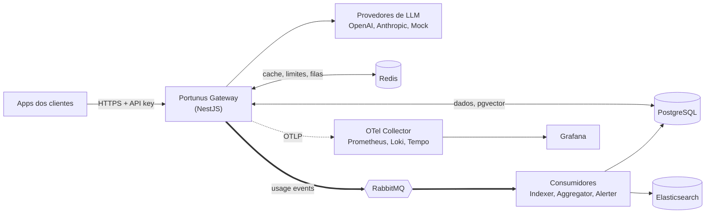
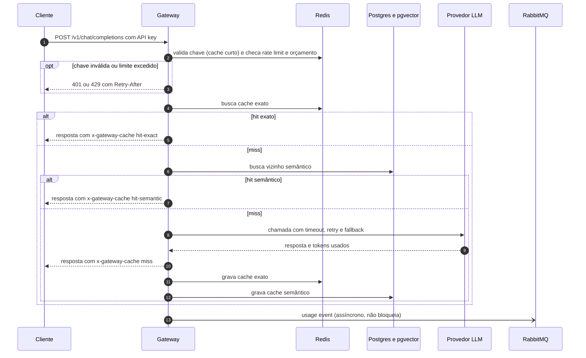
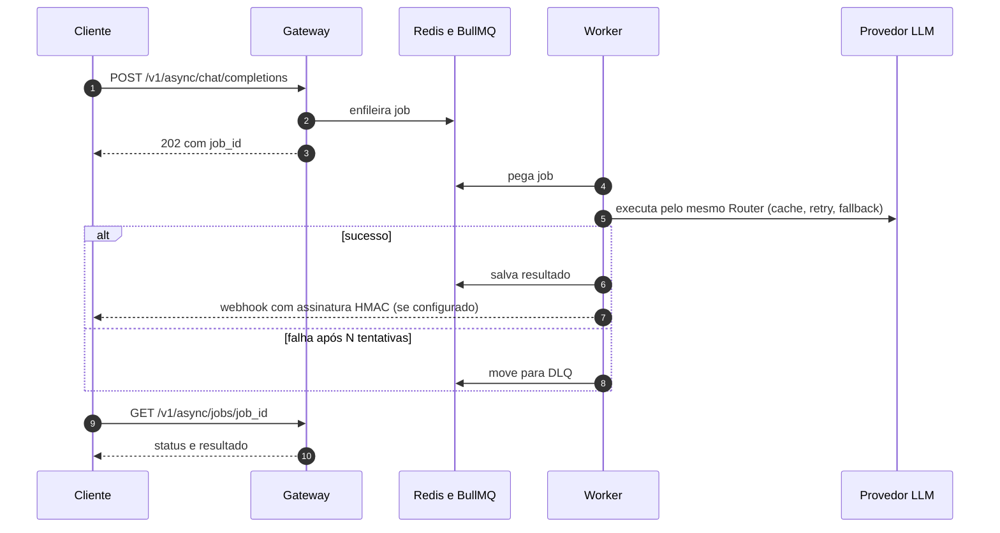

# ARQUITETURA.md — Portunus Gateway

> Complementa o [`CONTEXT.md`](./CONTEXT.md) (o **quê** e o **porquê**). Este documento descreve o **como**: componentes, fluxos, dados, resiliência e observabilidade.
> Status: **proposta inicial**. Itens marcados com _(a validar)_ dependem de medição ou de decisão durante a construção. Decisões firmes viram ADRs em `docs/adr/`.
> Diagrama completo em [`arquitetura.mermaid`](./arquitetura.mermaid).

---

## 1. Visão geral

O gateway é uma aplicação NestJS que expõe uma API compatível com a OpenAI. Cada requisição passa por uma esteira (autenticação → limites → cache → roteamento → provedor) e, **depois** de responder, publica um evento de uso que alimenta busca, custo e alertas. Nada que seja secundário (logs, indexação, métricas) pode atrasar ou derrubar a resposta.



> A versão detalhada (com todos os módulos, workers e fluxos assíncronos) está em `arquitetura.mermaid`.

## 2. Princípios

1. **Inferência primeiro.** Se Elasticsearch, RabbitMQ ou OpenTelemetry caírem, as respostas continuam saindo.
2. **Compatibilidade com OpenAI.** Quem já usa o SDK só troca `baseURL` e `apiKey`.
3. **Isolamento por tenant.** Dados, cache, limites e custos nunca se misturam.
4. **Mock primeiro.** Desenvolvimento, testes e carga rodam contra um provedor falso e determinístico. Provedor real só em demos.
5. **Tudo rastreável.** Cada chamada tem `request_id` e `trace_id` que aparecem em logs, métricas, traces e no índice de busca.
6. **Falhas explícitas.** Para cada dependência, o comportamento quando ela cai está definido (seção 8).

## 3. Componentes

| Componente                  | Responsabilidade                                                                 | Tecnologia                                      |
| --------------------------- | -------------------------------------------------------------------------------- | ----------------------------------------------- |
| **API de inferência**       | Recebe chat/embeddings no formato OpenAI, streaming SSE, erros no formato OpenAI | NestJS (Fastify)                                |
| **Auth e Tenant**           | Valida API key (hash), carrega tenant e políticas                                | NestJS guard, Postgres, Redis (cache curto)     |
| **Rate limit e Orçamento**  | Limites por tenant/chave, orçamento mensal                                       | Redis (janela deslizante/token bucket)          |
| **Cache**                   | Exato (hash) e semântico (embedding)                                             | Redis, pgvector                                 |
| **Router**                  | Resolve alias → provedores; retry, circuit breaker, fallback                     | Módulo próprio                                  |
| **Provider Adapters**       | Traduz o formato OpenAI para cada provedor e de volta                            | OpenAI, Anthropic, Mock                         |
| **Publicador de eventos**   | Publica `usage events` sem bloquear a resposta; outbox para garantir entrega     | RabbitMQ, Postgres                              |
| **API assíncrona e Worker** | Jobs e batch, callbacks, DLQ                                                     | BullMQ (Redis)                                  |
| **Consumidores**            | Indexer (→ Elasticsearch), Aggregator (→ custo/orçamento), Alerter               | Processo separado                               |
| **Admin API**               | Tenants, chaves, aliases, preços, relatórios, busca de logs                      | NestJS                                          |
| **CLI de Evals**            | Roda suites de qualidade e compara configurações                                 | Pacote Node (CLI)                               |
| **Telemetria**              | Métricas, traces e logs                                                          | OpenTelemetry, Prometheus, Tempo, Loki, Grafana |

## 4. Fluxos principais

### 4.1 Requisição síncrona



Passos em ordem (a ordem importa: o mais barato e o que mais protege vem primeiro):

1. Autenticação e carga do tenant.
2. Rate limit (requisições e tokens por minuto).
3. Orçamento do mês.
4. Cache exato.
5. Cache semântico.
6. Router → provedor (com retry, circuit breaker e fallback).
7. Cálculo de custo e gravação em cache.
8. Resposta ao cliente.
9. Publicação do usage event (fora do caminho crítico).

### 4.2 Streaming (SSE)

- O gateway repassa os chunks do provedor à medida que chegam.
- **Fallback só é possível antes do primeiro byte.** Depois que o stream começou, uma falha encerra o stream com um evento de erro (decisão consciente: trocar de provedor no meio quebraria a resposta).
- Tokens e custo vêm do último chunk (`usage`) do provedor; se não vierem, estima-se por contagem local _(a validar)_.
- Cache de resposta em stream: a resposta completa é gravada ao final e, em hit, é reproduzida como stream.

### 4.3 Chamada assíncrona e batch



- O worker reutiliza exatamente o mesmo pipeline da chamada síncrona (cache, limites, custo), sem caminho paralelo duplicado.
- Batch: N prompts em uma chamada geram N jobs com concorrência limitada por tenant.
- DLQ com endpoint de reprocessamento.

### 4.4 Eventos, logs e custo

1. Ao final de cada chamada, o gateway grava o evento na tabela **outbox** (Postgres) e o publica no RabbitMQ (`gateway.events`).
2. Um relay reenvia eventos do outbox que não foram confirmados (cobre queda do RabbitMQ).
3. Três filas independentes consomem o mesmo evento:
   - **Indexer:** aplica redação de PII, respeita `storeContent` do tenant e indexa no Elasticsearch.
   - **Aggregator:** atualiza `UsageAggregate` no Postgres e os contadores de orçamento no Redis.
   - **Alerter:** dispara alertas (80% do orçamento, anomalias).
4. Entrega _at-least-once_; consumidores são **idempotentes** pelo `event_id`.
5. Mensagens que falham repetidamente vão para a DLQ da respectiva fila.

### 4.5 Evals

- A CLI lê uma suite (YAML/JSON), chama o gateway como qualquer cliente (usando uma chave de tenant de teste) e avalia cada resposta pelo critério definido (contém, regex, JSON schema, similaridade semântica, LLM-as-judge).
- Gera relatório (aprovação, score, custo, latência) e compara duas configurações lado a lado.
- No CI, retorna código de saída diferente de zero se a aprovação ficar abaixo do limite.

## 5. Dados

### 5.1 PostgreSQL (fonte da verdade)

| Tabela                           | Conteúdo                                                                                         |
| -------------------------------- | ------------------------------------------------------------------------------------------------ |
| `tenants`                        | nome, status, orçamento mensal, modo de orçamento, flags de PII e armazenamento de conteúdo      |
| `api_keys`                       | tenant, hash, prefixo visível, expiração, revogação, último uso                                  |
| `providers`, `model_prices`      | provedores e preço por modelo (entrada/saída por 1M tokens), com vigência                        |
| `model_aliases`, `alias_targets` | apelido → lista ordenada de provedor+modelo, timeout, retries                                    |
| `rate_limit_policies`            | limites por tenant/chave                                                                         |
| `semantic_cache_entries`         | tenant, hash de contexto (modelo, system prompt, parâmetros), `embedding vector`, resposta, hits |
| `usage_aggregates`               | tenant, dia, modelo → requisições, tokens, custo, hits de cache                                  |
| `async_jobs`                     | estado, requisição, resultado, tentativas, callback                                              |
| `outbox_events`                  | payload, `published_at`                                                                          |
| `processed_events`               | `event_id` por consumidor (idempotência)                                                         |

### 5.2 Redis

| Chave (padrão)                | Uso                                                    |
| ----------------------------- | ------------------------------------------------------ |
| `auth:key:{hash}`             | tenant e políticas da chave, TTL curto                 |
| `rl:{tenant}:{janela}`        | contadores de rate limit                               |
| `budget:{tenant}:{aaaamm}`    | consumo corrente do mês (reconciliado pelo Aggregator) |
| `cache:exact:{tenant}:{hash}` | resposta em cache exato, com TTL                       |
| `cb:{provider}`               | estado do circuit breaker                              |
| Filas BullMQ                  | `async-chat`, `webhooks`                               |

### 5.3 RabbitMQ

- Exchange `gateway.events` (tipo _topic_).
- Routing keys: `usage.completed`, `usage.failed`, `budget.threshold`.
- Filas: `q.indexer`, `q.aggregator`, `q.alerter`, cada uma com _dead-letter exchange_ `gateway.dlx` e fila `.dlq` correspondente.
- Mensagens persistentes, com `event_id` (UUID) e `trace_id` nos headers.

### 5.4 Elasticsearch

- Índice `request-logs-*` com _index template_ e mapeamento explícito (nada de _dynamic mapping_ em campos críticos).
- Campos: `tenant_id`, `request_id`, `trace_id`, `model`, `provider`, `attempts[]`, `status`, `latency_ms`, `tokens_in`, `tokens_out`, `cost_usd`, `cache`, `prompt`, `response`, `@timestamp`.
- `prompt` e `response` como `text` (busca full-text); demais como `keyword`/numéricos.
- ILM: dados completos por 30 dias _(a validar)_; depois removidos (agregados ficam no Postgres).

## 6. Cache

**Cache exato**

- Chave = hash de `{tenant, modelo resolvido, messages normalizadas, parâmetros que afetam a saída}`.
- Só grava respostas bem-sucedidas e completas.

**Cache semântico**

- Escopo: mesmo tenant, mesmo modelo resolvido, mesmo hash do system prompt e dos parâmetros.
- Gera o embedding do prompt e busca o vizinho mais próximo; só aceita se a similaridade ≥ limiar (padrão `0.92`, ajustável por tenant/rota) _(a validar com casos de teste)_.
- Desligado por padrão para: `tools`/function calling, `temperature` acima do limite configurado e conversas muito longas.
- Cada entrada guarda o número de hits e a data, para análise de qualidade e expurgo.
- Controle por requisição: header `x-gateway-cache-control: no-cache`.

**Métricas obrigatórias:** hit rate (exato e semântico), economia estimada em USD, similaridade média dos hits.

## 7. Resiliência

| Mecanismo           | Comportamento                                                                                          |
| ------------------- | ------------------------------------------------------------------------------------------------------ |
| **Timeout**         | Por rota/alias; tempo total e tempo até o primeiro byte (streaming)                                    |
| **Retry**           | Backoff exponencial com jitter, só para erros transitórios (429, 5xx, timeout); respeita `Retry-After` |
| **Circuit breaker** | Por provedor: fechado → aberto após N falhas consecutivas → semiaberto após X segundos para testar     |
| **Fallback**        | Próximo item da lista do alias; todas as tentativas ficam em `attempts[]`                              |
| **Rate limit**      | Retorna `429` com `Retry-After` e `x-ratelimit-*`                                                      |
| **Idempotência**    | Eventos e jobs com `event_id`/`job_id` únicos                                                          |

## 8. Comportamento quando uma dependência cai

| Dependência fora   | Inferência síncrona                                                                                | O que degrada                                                                          |
| ------------------ | -------------------------------------------------------------------------------------------------- | -------------------------------------------------------------------------------------- |
| **Provedor LLM**   | Continua via fallback; se todos falharem, `502/503`                                                | Custo e latência podem subir                                                           |
| **Redis**          | Continua; cache exato desligado; rate limit e orçamento em _fail-open_ com alerta _(configurável)_ | Sem proteção de limites; async indisponível (`503`)                                    |
| **PostgreSQL**     | Continua para chaves já em cache no Redis; sem cache semântico, sem outbox                         | Novas chaves não autenticam; eventos vão para buffer limitado em memória _(a validar)_ |
| **RabbitMQ**       | Continua; eventos acumulam no outbox e são reenviados                                              | Logs e custos atrasam                                                                  |
| **Elasticsearch**  | Continua; eventos acumulam na fila do Indexer                                                      | Busca de logs indisponível                                                             |
| **OTel Collector** | Continua; telemetria é descartada                                                                  | Perda temporária de métricas e traces                                                  |

Cada linha dessa tabela deve virar um **teste de caos** simples (derrubar o container e verificar o comportamento) e uma demonstração para o README.

## 9. Observabilidade

**Métricas (Prometheus)**
`gateway_requests_total{tenant,model,provider,status,cache}` · `gateway_request_duration_seconds` · `gateway_provider_duration_seconds{provider,model}` · `gateway_tokens_total{tenant,model,direction}` · `gateway_cost_usd_total{tenant,model}` · `gateway_cache_hits_total{type}` · `gateway_cache_savings_usd_total` · `gateway_ratelimit_rejections_total{tenant}` · `gateway_circuit_state{provider}` · `gateway_queue_depth{queue}` · `gateway_dlq_size{queue}` · `gateway_event_consumer_lag{consumer}`

> Cuidado com cardinalidade: `tenant` é aceitável; `request_id` e `trace_id` **nunca** viram label.

**Traces (Tempo)**
Um span por etapa: `auth`, `ratelimit`, `budget`, `cache.exact`, `cache.semantic`, `router`, `provider.call` (um por tentativa), `event.publish`. O `trace_id` é propagado nos headers da mensagem RabbitMQ, e o span do consumidor continua o mesmo trace.

**Logs (Loki)**
JSON estruturado (pino) com `request_id`, `trace_id`, `tenant_id`. Logs de aplicação **não contêm prompts nem respostas**; o conteúdo existe apenas no Elasticsearch, com redação de PII.

**Dashboards (Grafana)**

1. Visão geral: req/s, erros, p50/p95/p99, cache hit rate.
2. Custo: por tenant/modelo/dia, economia do cache, projeção do mês.
3. Provedores: latência, erros, estado do circuit breaker, fallbacks.
4. Filas e eventos: profundidade, DLQ, lag dos consumidores.

**Alertas**
Erro acima de X% por 5 min · p95 acima do objetivo · circuito aberto · orçamento acima de 80% · DLQ crescendo · lag alto de consumidor.

## 10. Segurança

- API keys de tenant: geradas aleatoriamente com alta entropia, guardadas só como hash (SHA-256), prefixo visível para identificação, exibidas uma única vez.
- Chaves de provedores apenas em variáveis de ambiente/secrets do gateway.
- Admin com credencial separada das chaves de tenant.
- Webhooks assinados com HMAC; URLs de callback validadas contra SSRF (bloquear IPs privados/loopback).
- Validação de entrada e limite de tamanho de corpo em todas as rotas.
- PII: redação configurável antes de indexar; opção de não armazenar conteúdo.
- Logs de aplicação sem conteúdo de prompts.

## 11. Estrutura sugerida do repositório

```
portunus-gateway/
├── apps/
│   ├── gateway/            # API de inferência, admin e async (NestJS)
│   ├── consumers/          # Indexer, Aggregator, Alerter e worker BullMQ
│   ├── evals-cli/          # CLI de avaliação
│   └── mock-provider/      # servidor HTTP que imita a API da OpenAI (testes e carga)
├── libs/
│   ├── common/             # tipos, erros no formato OpenAI, utilitários
│   ├── telemetry/          # setup OpenTelemetry e métricas
│   ├── events/             # contratos dos eventos e publisher
│   └── database/           # schema Drizzle, client e migrations (fonte única do schema)
├── infra/
│   ├── docker-compose.yml  # perfis: core, observability, full
│   ├── otel/               # configuração do collector
│   ├── grafana/            # dashboards e alertas em JSON
│   └── elasticsearch/      # index templates e ILM
├── load-tests/             # cenários k6
├── evals/                  # suites de exemplo
├── docs/
│   ├── adr/                # decisões de arquitetura
│   └── specs/              # specs de features e tickets (spec-driven)
├── CONTEXT.md
├── ARQUITETURA.md
└── README.md
```

Módulos dentro de `apps/gateway`: `auth`, `tenants`, `inference`, `ratelimit`, `budget`, `cache`, `routing`, `providers`, `resilience`, `async`, `events`, `logs-search`, `admin`, `pricing`.

## 12. Infra local

`docker compose up` com perfis:

- **core:** gateway, consumers, PostgreSQL+pgvector, Redis, RabbitMQ, provedor mock.
- **search:** Elasticsearch (e Kibana opcional).
- **observability:** OTel Collector, Prometheus, Loki, Tempo, Grafana.
- **full:** tudo.

O Elasticsearch é o serviço mais pesado; o perfil separado permite desenvolver sem ele no dia a dia.

## 13. Desempenho: metas e medição

| Métrica                                         | Meta inicial _(a validar)_                                | Como medir                                       |
| ----------------------------------------------- | --------------------------------------------------------- | ------------------------------------------------ |
| Overhead do gateway (cache miss, contra o mock) | p95 < 20 ms                                               | k6 comparando gateway vs. chamada direta ao mock |
| Resposta de cache exato                         | p95 < 30 ms                                               | k6 com prompts repetidos                         |
| Resposta de cache semântico                     | p95 < 100 ms                                              | k6 com paráfrases                                |
| Throughput contra o mock                        | ≥ 500 req/s em máquina de desenvolvimento                 | k6, descrevendo a máquina usada                  |
| Atraso do pipeline de eventos                   | p95 < 5 s do fim da chamada até aparecer no Elasticsearch | timestamp do evento vs. do documento             |

Os valores reais medidos, com a máquina descrita, vão para o README.

## 14. Decisões de arquitetura (ADRs a registrar)

| #   | Decisão                                                                                                             | Alternativas / ponto de atenção                                                                                                         | Status    |
| --- | ------------------------------------------------------------------------------------------------------------------- | --------------------------------------------------------------------------------------------------------------------------------------- | --------- |
| 001 | API compatível com OpenAI                                                                                           | API própria                                                                                                                             | Proposto  |
| 002 | BullMQ para jobs e RabbitMQ para eventos                                                                            | Usar só um dos dois. Justificar: jobs com retry/prioridade/DLQ vs. fan-out para vários consumidores. Revisar se a separação se sustenta | Proposto  |
| 003 | pgvector para cache semântico                                                                                       | Redis Stack/RediSearch, banco vetorial dedicado                                                                                         | Proposto  |
| 004 | Postgres como fonte da verdade de custo e orçamento; Elasticsearch só para busca                                    | Custo calculado a partir do Elasticsearch                                                                                               | Proposto  |
| 005 | Padrão outbox para publicar eventos                                                                                 | Publicar direto e aceitar perda                                                                                                         | Proposto  |
| 006 | Rate limit e orçamento em _fail-open_ quando o Redis cai                                                            | _Fail-closed_                                                                                                                           | Proposto  |
| 007 | Fallback apenas antes do primeiro byte em streaming                                                                 | Reiniciar o stream com outro provedor                                                                                                   | Proposto  |
| 008 | Fastify em vez de Express no NestJS                                                                                 | Medir na Fase 1                                                                                                                         | A validar |
| 009 | Consumidores em processo separado do gateway                                                                        | Mesmo processo                                                                                                                          | Proposto  |
| 010 | Nome do projeto: Portunus Gateway, escopo `@portunus/*`                                                             | Manter `llm-gateway`; Janus, Hufu, Cursus                                                                                               | Aceito    |
| 011 | Resolução de pacotes do workspace: pacotes compilados + project references + condição de export para o código-fonte | `paths` no tsconfig; pacote "just-in-time" apontando para `src`                                                                         | Aceito    |

## 15. Ordem sugerida de construção

1. **Fundação:** monorepo, Compose (Postgres, Redis), CI, provedor mock, logs estruturados.
2. **Gateway básico:** auth por API key, tenants, chat completions (mock + um provedor real), aliases, streaming, cálculo de custo.
3. **Resiliência:** timeout, retry, circuit breaker, fallback, rate limit.
4. **Cache:** exato e semântico, headers de diagnóstico, métricas de economia.
5. **Observabilidade:** OpenTelemetry, Prometheus, Loki, Tempo, Grafana e alertas.
6. **Mensageria e logs:** RabbitMQ, outbox, Indexer, Aggregator, Alerter, busca, PII, DLQ.
7. **Assíncrono:** BullMQ, batch, webhooks, DLQ e reprocessamento.
8. **Evals:** suites, CLI, comparação A/B e gate no CI.
9. **Acabamento:** testes de carga e de caos, README com números reais, ADRs, demo de 2–3 minutos.

Cada etapa termina com algo executável e demonstrável antes de avançar. Se o tempo apertar, cortar 7 e 8 antes de reduzir a qualidade de 2 a 6.
