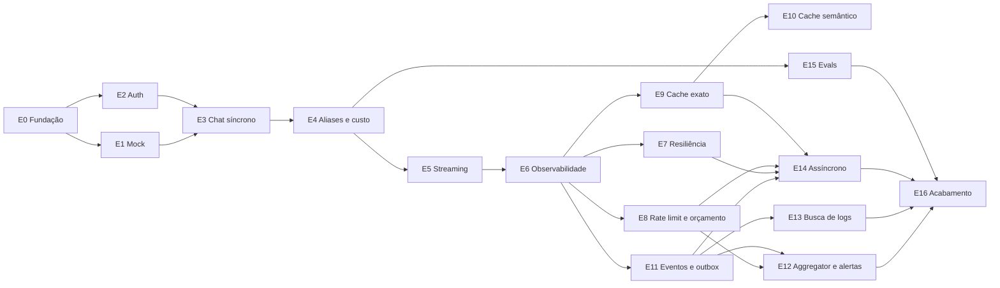

# ROADMAP.md — Portunus Gateway

> Plano de desenvolvimento em **épicos**. Complementa o [`CONTEXT.md`](./CONTEXT.md) (o quê e por quê) e o [`ARQUITETURA.md`](./ARQUITETURA.md) (como).
> Cada épico descreve **o que** será entregue. Os **tickets** só nascem em `docs/specs/` quando o épico começa, para não envelhecerem antes da hora.

---

## 1. Como ler este roadmap

- **Épico:** um bloco de valor que termina com algo **executável e demonstrável**. Não se começa o próximo sem fechar a demo do anterior.
- **Marco:** um agrupamento de épicos que, juntos, entregam uma capacidade visível do produto.
- Cada épico traz: objetivo, entregáveis, fora de escopo, dependências, ADRs envolvidos, pontos de atenção (o que um dev pleno não pode deixar passar) e critério de pronto (a demo).
- **Status:** `Não iniciado` → `Em andamento` → `Concluído`. Atualize a tabela da seção 3 ao abrir e fechar cada épico.

## 2. Regras transversais (valem para todo épico)

1. **Spec antes de código.** Ao abrir um épico, crie a spec em `docs/specs/` e quebre em tickets curtos.
2. **TDD nas regras de negócio e nos contratos** (chave de cache, custo, rate limit, orçamento, fallback, circuit breaker, schemas de eventos).
3. **Telemetria junto com a feature (a partir do E6).** Todo épico entrega as próprias métricas, spans e painéis. Instrumentar depois não é uma opção.
4. **Admin junto com o domínio.** Cada épico entrega os endpoints de administração do seu domínio (ex.: E8 entrega o CRUD de políticas de limite). Não existe um épico separado de "admin".
5. **Falha explícita.** Se o épico introduz uma dependência (Redis, RabbitMQ, ES...), ele define e testa o comportamento quando ela cai (ARQUITETURA §8).
6. **Decisão nova vira ADR** em `docs/adr/`.
7. **Verificação obrigatória** ao fim de cada ticket: `typecheck`, `lint`, `test`, `test:int` e chamada real contra o mock (CLAUDE.md §5).
8. **Docs em sincronia:** a seção de comandos do CLAUDE.md acompanha o `package.json`, e o README cresce a cada marco.

## 3. Visão geral

| #   | Épico                            | Marco                       | Status       |
| --- | -------------------------------- | --------------------------- | ------------ |
| E0  | Fundação do monorepo             | M1 — Fundação               | Em andamento |
| E1  | Provedor mock                    | M1 — Fundação               | Não iniciado |
| E2  | Tenants, chaves e autenticação   | M2 — Gateway básico         | Não iniciado |
| E3  | Chat completions síncrono        | M2 — Gateway básico         | Não iniciado |
| E4  | Aliases, preços e custo          | M2 — Gateway básico         | Não iniciado |
| E5  | Streaming (SSE)                  | M2 — Gateway básico         | Não iniciado |
| E6  | Observabilidade (fundação)       | M3 — Visibilidade           | Não iniciado |
| E7  | Resiliência e multi-provedor     | M4 — Proteção               | Não iniciado |
| E8  | Rate limit e orçamento           | M4 — Proteção               | Não iniciado |
| E9  | Cache exato                      | M5 — Cache                  | Não iniciado |
| E10 | Cache semântico                  | M5 — Cache                  | Não iniciado |
| E11 | Eventos de uso e outbox          | M6 — Eventos, custo e busca | Não iniciado |
| E12 | Aggregator, relatórios e alertas | M6 — Eventos, custo e busca | Não iniciado |
| E13 | Indexação e busca de logs        | M6 — Eventos, custo e busca | Não iniciado |
| E14 | Assíncrono e batch               | M7 — Assíncrono             | Não iniciado |
| E15 | Evals                            | M8 — Qualidade              | Não iniciado |
| E16 | Carga, caos e acabamento         | M9 — Acabamento             | Não iniciado |

### Dependências entre épicos

> A partir do E6, os épicos E7, E8, E9 e E11 são independentes entre si. A ordem numérica é a recomendada, mas pode ser trocada se fizer sentido no momento.

### Diferenças em relação à ordem do ARQUITETURA.md §15

| Mudança                                                    | Motivo                                                                                                                |
| ---------------------------------------------------------- | --------------------------------------------------------------------------------------------------------------------- |
| Provedor mock virou um épico próprio (E1)                  | "Mock primeiro" é um invariante; o mock precisa simular latência, falhas e streaming antes que o gateway dependa dele |
| Observabilidade subiu para logo após o gateway básico (E6) | Usar traces para **entender** retry, fallback e cache enquanto eles são construídos, em vez de instrumentar depois    |
| Orçamento entra junto com o rate limit (E8)                | O contador no Redis é incrementado pelo gateway desde cedo; o Aggregator (E12) só reconcilia com o Postgres           |
| Cache dividido em exato (E9) e semântico (E10)             | O semântico traz pgvector, embeddings, índices vetoriais e calibração de limiar; merece um ciclo próprio              |
| Mensageria dividida em E11, E12 e E13                      | Outbox/RabbitMQ, agregação de custo e busca no Elasticsearch são aprendizados distintos e demos distintas             |

---

## 4. Épicos

### M1 — Fundação

#### E0 — Fundação do monorepo

**Objetivo:** ter um monorepo que compila, testa, faz lint e roda no CI, com um gateway Nest "vazio" de pé.

**Entregáveis**

- Repositório git, `main` protegida, convenção de branches e commits.
- Raiz do workspace à mão: `package.json`, `pnpm-workspace.yaml`, `tsconfig.base.json`, `.nvmrc` (Node 22), `engines`.
- ESLint (typescript-eslint strict) + Prettier; Vitest com plugin SWC; separação entre `test` (unitário) e `test:int` (Testcontainers).
- Esqueleto do `apps/gateway`: Nest + Fastify, `main.ts`, `app.module.ts`, `nest-cli.json` com `spec: false`, rota `GET /health`.
- Configuração validada com Zod na inicialização (o app não sobe com config inválida).
- Logger pino (JSON estruturado) com `request_id` por requisição.
- Esqueletos de `libs/common`, `libs/telemetry`, `libs/events` e `libs/database` como pacotes `@portunus/*`.
- `infra/docker-compose.yml` com perfil `core` inicial (Postgres + pgvector, Redis).
- CI no GitHub Actions: install, typecheck, lint, test, test:int.

**Fora de escopo:** qualquer rota de negócio, banco com tabelas.

**Depende de:** nada.
**ADRs:** registrar 008 (Fastify em vez de Express), com a medição prevista para o E3.

**Pontos de atenção:** resolução de módulos entre pacotes do workspace (paths do TS vs. `exports` do `package.json`); CommonJS e o `emitDecoratorMetadata` com SWC; cache do pnpm no CI; graceful shutdown (SIGTERM) desde o primeiro dia.

**Pronto quando:** `pnpm install && pnpm typecheck && pnpm lint && pnpm test` passam local e no CI, e `curl /health` responde com o Compose `core` de pé.

---

#### E1 — Provedor mock

**Objetivo:** um servidor que imita a API da OpenAI de forma **determinística e controlável**, base de todos os testes e da carga.

**Entregáveis**

- `apps/mock-provider` com `POST /v1/chat/completions` (normal e streaming SSE com chunk final de `usage`) e `POST /v1/embeddings`.
- Respostas determinísticas (mesma entrada → mesma saída) e contagem de tokens previsível.
- Cenários controláveis por configuração ou header: latência fixa/aleatória, tempo até o primeiro byte, taxa de erro, `429` com `Retry-After`, `500`/`503`, timeout e **falha no meio do stream**.
- Serviço no perfil `core` do Compose.

**Fora de escopo:** semântica real nos embeddings (ver decisão em aberto no E10).

**Depende de:** E0.
**ADRs:** nenhum previsto.

**Pontos de atenção:** o mock precisa ser rápido o bastante para não ser o gargalo na carga (E16); controle de cenário por requisição para testes paralelos não interferirem entre si.

**Pronto quando:** o SDK oficial da OpenAI, apontado para o mock, recebe respostas normais, em stream e cada um dos erros configurados.

---

### M2 — Gateway básico

#### E2 — Tenants, chaves e autenticação

**Objetivo:** só entra quem tem chave válida, e cada requisição sabe a qual tenant pertence.

**Entregáveis**

- `libs/database`: Drizzle, drizzle-kit, client, primeira migration (`tenants`, `api_keys`); Testcontainers configurado para testes de integração com Postgres.
- Geração de chave com alta entropia, prefixo visível, armazenamento só do hash SHA-256, exibição única.
- Guard de autenticação: chave inexistente, revogada ou vencida → `401` no formato OpenAI.
- Cache curto da chave no Redis (`auth:key:{hash}`) e invalidação na revogação.
- Credencial de admin separada; endpoints de admin para criar tenant, emitir chave e revogar chave.
- Atualização de "último uso" fora do caminho crítico.

**Fora de escopo:** limites, orçamento e políticas de PII (os campos existem no tenant, mas o comportamento vem nos épicos E8 e E13).

**Depende de:** E0.
**ADRs:** formato da chave e estratégia de hash (por que SHA-256 e não bcrypt/argon2 para API keys).

**Pontos de atenção:** comparação em tempo constante; janela entre revogar a chave e o cache do Redis expirar; escrita de "último uso" a cada requisição gera carga no banco (throttle); isolamento por tenant começa aqui.

**Pronto quando:** o admin cria um tenant, emite uma chave e a chave autentica; após a revogação, a mesma chave recebe `401`.

---

#### E3 — Chat completions síncrono

**Objetivo:** um app com o SDK da OpenAI faz uma chamada de chat pelo gateway e recebe a resposta do mock.

**Entregáveis**

- Schemas Zod de request/response de `chat.completions` (fonte única dos tipos) e pipe de validação próprio.
- Exception filter que converte qualquer erro para o formato de erro da OpenAI; limite de tamanho de corpo.
- Port `LlmProvider` no domínio e `MockAdapter` na infraestrutura (padrão Adapter).
- Use case de inferência como **esteira** explícita (Chain of Responsibility), já preparada para receber as próximas etapas sem reescrita.
- `request_id` gerado e devolvido em header.
- Medição inicial de overhead com um cenário k6 simples (base do ADR 008).

**Fora de escopo:** aliases, custo, streaming, provedores reais.

**Depende de:** E1, E2.
**ADRs:** 001 (API compatível com OpenAI).

**Pontos de atenção:** campos desconhecidos no request (rejeitar ou repassar?); a esteira precisa ser reutilizável pelo worker assíncrono (E14) sem duplicação, ou seja, nada de lógica de negócio no controller.

**Pronto quando:** um script com o SDK oficial da OpenAI (só trocando `baseURL` e `apiKey`) recebe resposta do mock via gateway, e erros de validação chegam no formato que o SDK entende.

---

#### E4 — Aliases, preços e custo

**Objetivo:** o app pede `inteligente`, o gateway decide quem atende e informa quanto custou.

**Entregáveis**

- Tabelas `providers`, `model_aliases`, `alias_targets`, `model_prices` (com vigência).
- Resolução de alias → lista ordenada de provedor+modelo (neste épico usa só o primeiro alvo).
- `OpenAIAdapter` (primeiro provedor real, só para demo e nunca em teste).
- Cálculo de custo por chamada (TDD), usando o preço **vigente na data da chamada**.
- Headers de diagnóstico: provedor, custo e request id (nomes definidos na spec).
- `POST /v1/embeddings` passando pela mesma esteira, com custo.
- Endpoints de admin para aliases e preços.

**Fora de escopo:** fallback entre alvos (E7).

**Depende de:** E3.
**ADRs:** representação de dinheiro (decimal/`numeric` vs. inteiro em micro-dólares vs. float).

**Pontos de atenção:** ponto flutuante em dinheiro; preço mudando no meio do mês (invariante 9); cache da resolução de alias e como invalidá-lo; aceitar ou não o nome de um modelo real além dos aliases.

**Pronto quando:** a mesma chamada com o alias `rapido` e depois com `inteligente` é atendida por modelos diferentes, com custo correto no header; trocar o preço não altera o custo de chamadas passadas.

---

#### E5 — Streaming (SSE)

**Objetivo:** o texto chega aos poucos, como na OpenAI, com custo calculado ao final.

**Entregáveis**

- `stream: true` com repasse de chunks SSE pelo Fastify, no formato da OpenAI.
- Tokens e custo a partir do chunk final de `usage`; estratégia para quando o provedor não manda `usage`.
- Falha no meio do stream encerra com evento de erro, sem misturar respostas.
- Cancelamento: cliente desconecta → chamada ao provedor é abortada.
- Streaming também no `OpenAIAdapter`.

**Fora de escopo:** fallback em streaming (E7) e replay de cache em stream (E9).

**Depende de:** E4.
**ADRs:** estimativa de tokens sem `usage` (tokenizer local? dependência nova).

**Pontos de atenção:** backpressure (cliente lento × provedor rápido); headers enviados antes do primeiro byte não podem mais mudar, então o custo não cabe em header no stream; vazamento de conexões abertas; proxies que fazem buffer de SSE.

**Pronto quando:** o SDK da OpenAI consome um stream pelo gateway; o mock configurado para falhar no meio gera um erro limpo; derrubar o cliente aborta a chamada ao mock.

---

### M3 — Visibilidade

#### E6 — Observabilidade (fundação)

**Objetivo:** ver cada requisição de ponta a ponta antes de construir as partes mais complexas.

**Entregáveis**

- `libs/telemetry`: setup do OpenTelemetry (traces + métricas) e auto-instrumentação de HTTP, Fastify, ioredis e pg.
- Span por etapa da esteira (`auth`, `provider.call`...), com o padrão de nomes que os próximos épicos vão seguir.
- Métricas base: `gateway_requests_total`, `gateway_request_duration_seconds`, `gateway_provider_duration_seconds`, `gateway_tokens_total`, `gateway_cost_usd_total`.
- Logs pino com `trace_id`, `request_id` e `tenant_id`, enviados ao Loki.
- Perfil `observability` no Compose: OTel Collector, Prometheus, Loki, Tempo e Grafana provisionados como código.
- Dashboard "Visão geral" (req/s, erros, p50/p95/p99) com link de log → trace.

**Fora de escopo:** dashboards e alertas de provedores, custo e filas (entram com seus épicos).

**Depende de:** E5.
**ADRs:** convenção de nomes e labels de métricas (política de cardinalidade).

**Pontos de atenção:** cardinalidade (`request_id`/`trace_id` nunca como label, invariante 6); o collector fora do ar não pode afetar a resposta; sampling de traces; logs **sem** prompt nem resposta (invariante 5).

**Pronto quando:** uma chamada aparece no Grafana como trace com os spans da esteira, a métrica correspondente sobe e o log leva ao trace; com o collector derrubado, as respostas continuam saindo.

---

### M4 — Proteção

#### E7 — Resiliência e multi-provedor

**Objetivo:** o provedor principal cai e o cliente não percebe.

**Entregáveis**

- `AnthropicAdapter` (segundo provedor real), com tradução OpenAI ↔ Anthropic também no streaming.
- Timeouts por alias: tempo total e tempo até o primeiro byte.
- Retry com backoff exponencial e jitter, só para erros transitórios (429, 5xx, timeout), respeitando `Retry-After`.
- Circuit breaker por provedor (fechado → aberto → semiaberto), com estado no Redis (`cb:{provider}`).
- Fallback pela lista do alias; todas as tentativas registradas em `attempts[]`.
- Em streaming, fallback **só antes do primeiro byte**.
- `502/503` claros quando todos falham.
- Métricas `gateway_circuit_state`, fallbacks e retries; span por tentativa; dashboard "Provedores".

**Fora de escopo:** rate limit do próprio gateway (E8).

**Depende de:** E6.
**ADRs:** 007 (fallback só antes do primeiro byte); circuit breaker distribuído (Redis) vs. em memória por instância.

**Pontos de atenção:** retry multiplicando carga num provedor já degradado (retry storm); orçamento de tempo total somando tentativas; várias instâncias disputando a transição para semiaberto (race condition); erro `4xx` do cliente nunca deve disparar retry.

**Pronto quando:** com o mock configurado para falhar como "provedor A", a chamada é atendida pelo reserva; o trace mostra as tentativas; o circuito abre, fica visível no dashboard e fecha sozinho quando o mock volta.

---

#### E8 — Rate limit e orçamento

**Objetivo:** um cliente com bug não derruba os outros, e ninguém gasta além do combinado.

**Entregáveis**

- Tabela `rate_limit_policies` e endpoints de admin para limites e orçamento.
- Rate limit por tenant/chave em requisições/min e tokens/min, com operações atômicas no Redis (Lua).
- `429` com `Retry-After` e headers `x-ratelimit-*`.
- Contador de orçamento `budget:{tenant}:{aaaamm}` no Redis, incrementado pelo gateway após o cálculo de custo.
- Modos de orçamento: bloquear ou só alertar; aviso ao cruzar o limiar (ex.: 80%).
- Fail-open quando o Redis cai, com alerta.
- Métrica `gateway_ratelimit_rejections_total`.

**Fora de escopo:** reconciliação do orçamento com o Postgres (E12) e notificação do aviso por evento (E11/E12).

**Depende de:** E6 (e E4 para o custo).
**ADRs:** algoritmo de rate limit (janela fixa × janela deslizante × token bucket); 006 (fail-open).

**Pontos de atenção:** tokens/min exigem estimar antes da chamada e ajustar depois; concorrência no orçamento (duas chamadas passam juntas no último dólar); virada do mês e fuso horário; estratégia Strategy para trocar o algoritmo.

**Pronto quando:** um script em loop de um tenant recebe `429` enquanto outro tenant segue normal; um tenant com orçamento baixo é bloqueado (ou só alertado, conforme a regra); com o Redis derrubado, as chamadas passam.

---

### M5 — Cache

#### E9 — Cache exato

**Objetivo:** a mesma pergunta não é paga duas vezes.

**Entregáveis**

- Normalização das messages e chave canônica: hash de `{tenant, modelo resolvido, messages, parâmetros que afetam a saída}` (TDD).
- `cache:exact:{tenant}:{hash}` com TTL; grava só respostas completas e bem-sucedidas.
- Em stream: grava ao final e, em hit, reproduz como stream.
- Header `x-gateway-cache` (`hit-exact` / `miss`) e controle `x-gateway-cache-control: no-cache`; desligar por alias.
- Métricas de hit rate e economia estimada em USD (`gateway_cache_savings_usd_total`).
- Fail-open quando o Redis cai.

**Fora de escopo:** similaridade (E10).

**Depende de:** E6.
**ADRs:** quais parâmetros entram na chave e como serializar de forma canônica.

**Pontos de atenção:** ordem de chaves no JSON mudando o hash; stampede (várias requisições iguais em miss ao mesmo tempo); tamanho das respostas no Redis e política de memória; custo de um hit (zero) e como isso aparece no registro.

**Pronto quando:** a segunda chamada idêntica volta com `hit-exact`, sem chegar ao mock e muito mais rápida; o painel mostra a economia; o mesmo prompt em outro tenant dá `miss`.

---

#### E10 — Cache semântico

**Objetivo:** perguntas com o mesmo sentido reaproveitam a resposta.

**Entregáveis**

- Extensão `vector`, tabela `semantic_cache_entries` e índice vetorial.
- Embedding do prompt via `/v1/embeddings` da esteira (com o custo do embedding contabilizado).
- Escopo: mesmo tenant, mesmo modelo resolvido, mesmo hash de system prompt e parâmetros.
- Limiar de similaridade configurável (padrão `0.92`) por tenant/alias.
- Regras de exclusão: `tools`/function calling, temperatura acima do limite, conversas longas.
- Contador de hits e data por entrada; expurgo.
- Header `hit-semantic`; métricas de hit rate semântico e similaridade média.
- Suite de calibração com pares de paráfrases e de "parecidas mas diferentes" para medir falsos positivos.

**Fora de escopo:** ajuste automático do limiar.

**Depende de:** E9.
**ADRs:** 003 (pgvector); HNSW × IVFFlat; origem dos embeddings em teste.

**Pontos de atenção:** falso positivo é pior que miss (resposta errada com cara de certa); latência do embedding somada a todo miss; o custo do embedding pode superar a economia em tráfego com pouca repetição; o filtro por tenant combinado com a busca aproximada (filtrar antes ou depois do ANN).

**Pronto quando:** "Qual o prazo de reembolso?" seguido de "Em quantos dias consigo reembolso?" retorna `hit-semantic`; a suite de calibração mostra a taxa de acerto e de falsos positivos no limiar escolhido.

---

### M6 — Eventos, custo e busca

#### E11 — Eventos de uso e outbox

**Objetivo:** cada chamada vira um evento entregue de forma confiável, sem atrasar a resposta.

**Entregáveis**

- `libs/events`: schemas Zod de `usage.completed`, `usage.failed` e `budget.threshold`, com versão.
- Tabela `outbox_events`; gravação fora do caminho crítico; relay que publica e marca `published_at`.
- RabbitMQ no Compose `core`: exchange `gateway.events` (topic), filas `q.indexer`, `q.aggregator`, `q.alerter`, DLX `gateway.dlx` e filas `.dlq`.
- Publisher confirms; `event_id` e `trace_id` nos headers da mensagem.
- `apps/consumers` de pé, com base de consumidor idempotente (`processed_events`) e continuação do trace.
- Métricas de profundidade de fila, tamanho da DLQ e lag do consumidor; dashboard "Filas e eventos".

**Fora de escopo:** a lógica de cada consumidor (E12 e E13).

**Depende de:** E6.
**ADRs:** 002 (BullMQ para jobs e RabbitMQ para eventos); 005 (outbox); 009 (consumidores em processo separado).

**Pontos de atenção:** aqui o outbox é um buffer durável, não uma transação junto com um dado de negócio, então é preciso discutir o que isso garante; várias instâncias do relay (`FOR UPDATE SKIP LOCKED`); ordenação não garantida; Postgres fora (buffer limitado em memória); poison messages.

**Pronto quando:** com o RabbitMQ derrubado, as respostas continuam e os eventos acumulam no outbox; ao subir de novo, tudo é publicado; um consumidor que recebe o mesmo evento duas vezes processa uma vez só.

---

#### E12 — Aggregator, relatórios e alertas

**Objetivo:** saber quanto cada cliente e cada modelo custam, e ser avisado quando algo sai do normal.

**Entregáveis**

- Consumidor Aggregator: `usage_aggregates` (tenant, dia, modelo → requisições, tokens, custo, hits de cache).
- Reconciliação do contador de orçamento do Redis com o Postgres (fonte da verdade).
- Evento `budget.threshold` e consumidor Alerter (orçamento a 80%, anomalias).
- Relatórios no admin: custo por tenant, por modelo e por dia; economia gerada pelo cache.
- Dashboard "Custo" (por tenant/modelo/dia, economia, projeção do mês).
- Regras de alerta no Grafana: erro alto, p95 acima do objetivo, circuito aberto, DLQ crescendo, lag alto.

**Fora de escopo:** "prompts mais caros" (precisa do conteúdo, vem no E13).

**Depende de:** E8, E11.
**ADRs:** 004 (Postgres como fonte da verdade de custo); canal de notificação do Alerter.

**Pontos de atenção:** upsert concorrente no agregado; dedupe do alerta (não avisar 80% mil vezes); divergência Redis × Postgres e qual vence; fuso horário do "dia".

**Pronto quando:** depois de uma rajada de chamadas, o relatório de custo bate com a soma das chamadas; um tenant que cruza 80% gera um alerta único; os alertas disparam com o mock em falha.

---

#### E13 — Indexação e busca de logs

**Objetivo:** encontrar uma chamada pelo texto e entender o que aconteceu com ela.

**Entregáveis**

- Perfil `search` no Compose; index template `request-logs-*` com mapeamento explícito; ILM com retenção.
- Consumidor Indexer com redação de PII (e-mail, CPF, telefone, cartão) e respeito ao `storeContent` do tenant.
- Busca no admin: texto livre + filtros (tenant, período, modelo, erro, custo), com link para o trace.
- Relatório "prompts mais caros".

**Fora de escopo:** interface gráfica de busca (é só API; Kibana é opcional para inspeção).

**Depende de:** E11.
**ADRs:** abordagem de redação de PII (regex + validação, ex.: Luhn para cartão, × biblioteca).

**Pontos de atenção:** PII que escapa da redação; o conteúdo de um tenant nunca aparece na busca de outro; o Elasticsearch fora do ar → eventos acumulam na fila e reindexam depois; atraso do pipeline (meta p95 < 5 s).

**Pronto quando:** uma chamada é encontrada pelo texto com CPF mascarado; um tenant com `storeContent=false` aparece só com metadados; com o ES derrubado, as respostas continuam e a busca se atualiza quando ele volta.

---

### M7 — Assíncrono

#### E14 — Assíncrono e batch

**Objetivo:** tarefas longas e lotes sem manter conexão aberta e sem perder pedidos.

**Entregáveis**

- Filas BullMQ `async-chat` e `webhooks`; tabela `async_jobs`.
- `POST /v1/async/chat/completions` → `202` com `job_id`; `GET /v1/async/jobs/{id}`.
- Worker em `apps/consumers` reutilizando **a mesma esteira** do síncrono (limites, cache, custo, fallback).
- Batch: N prompts → N jobs, com concorrência limitada por tenant.
- Webhooks assinados com HMAC, com retry, e URL validada contra SSRF.
- DLQ e endpoint de reprocessamento.
- Redis fora → `503` nas rotas assíncronas.

**Fora de escopo:** priorização entre tenants além do limite de concorrência.

**Depende de:** E7, E8, E9, E11.
**ADRs:** idempotência na criação de job (header de idempotência? é contrato de API).

**Pontos de atenção:** job executado duas vezes (at-least-once) não pode cobrar duas vezes; rate limit aplicado no worker, não só no enfileiramento; SSRF via redirect e DNS rebinding; webhook de um tenant lento travando os outros.

**Pronto quando:** um lote de milhares de prompts é processado com aviso via webhook assinado; um job que sempre falha vai para a DLQ e é reprocessado pelo endpoint.

---

### M8 — Qualidade

#### E15 — Evals

**Objetivo:** uma mudança de prompt ou modelo que piora a qualidade é barrada automaticamente.

**Entregáveis**

- `apps/evals-cli`: suite em YAML validada com Zod (entrada + critério esperado).
- Runner que chama o gateway como um cliente qualquer (chave de tenant de teste).
- Critérios como Strategy: contém, regex, JSON schema, similaridade semântica e LLM-as-judge.
- Relatório: aprovação, score, custo e latência.
- Comparação A/B caso a caso (modelo A × B, prompt antigo × novo).
- Gate no CI: código de saída ≠ 0 abaixo do mínimo, listando os casos que pioraram; workflow com gateway + mock.
- Suites de exemplo em `evals/`.

**Fora de escopo:** interface web de resultados.

**Depende de:** E4 (o restante do gateway é opcional para os evals).
**ADRs:** como tornar evals determinísticos o suficiente para servir de gate (mock no CI × modelo real).

**Pontos de atenção:** não determinismo do LLM (temperatura, repetições, margem); LLM-as-judge tem custo e viés; o cache do gateway pode mascarar regressões (rodar com `no-cache`).

**Pronto quando:** um PR que altera um prompt de classificação e derruba a aprovação abaixo do mínimo falha no CI, com a lista dos casos que pioraram.

---

### M9 — Acabamento

#### E16 — Carga, caos e acabamento

**Objetivo:** provar com números e demonstrações que o sistema faz o que o CONTEXT.md promete.

**Entregáveis**

- Cenários k6 para cada meta do ARQUITETURA §13 (overhead, cache exato, cache semântico, throughput, atraso do pipeline de eventos).
- Testes de caos: um por linha da tabela do ARQUITETURA §8 (derrubar o container e verificar o comportamento).
- README com o problema, a demo e os números reais medidos (com a máquina descrita).
- ADRs revisados e atualizados com o que foi medido (ex.: 008 Fastify).
- Roteiro de demo de 2–3 minutos.

**Depende de:** E12, E13, E14, E15.

**Pontos de atenção:** medir com o gerador de carga e o gateway competindo pela mesma CPU; aquecimento antes de medir; reportar percentis, não médias.

**Pronto quando:** todos os critérios do CONTEXT.md §8 estão cobertos (ver seção 5).

---

## 5. Critérios de portfólio (CONTEXT.md §8) × épicos

| Critério                                                     | Onde é entregue                     |
| ------------------------------------------------------------ | ----------------------------------- |
| Um app com o SDK da OpenAI funciona apontando para o gateway | E3 (síncrono), E5 (streaming)       |
| Demonstrar cache economizando                                | E9, E10                             |
| Demonstrar provedor caindo sem o cliente perceber            | E7                                  |
| Demonstrar um cliente limitado sem afetar os outros          | E8                                  |
| Registro/busca fora do ar sem afetar as respostas            | E11, E13                            |
| Medição real de desempenho documentada                       | E3 (inicial), E16                   |
| Seguir uma requisição do início ao fim nos dashboards        | E6 (base), evolui em todo épico     |
| Teste de qualidade barra uma mudança ruim                    | E15                                 |
| README com problema, demo e como rodar                       | cresce a cada marco; fechado no E16 |

## 6. Linha de corte

Se o tempo apertar, a ordem de corte é: **E15 (Evals)** e depois **E14 (Assíncrono)**. Eles são isolados e cortá-los não afeta os demais. Não se reduz a qualidade de E2 a E13 para encaixar esses épicos.

## 7. Decisões em aberto

| Decisão                             | Até quando        | Contexto                                                                                                                                         |
| ----------------------------------- | ----------------- | ------------------------------------------------------------------------------------------------------------------------------------------------ |
| Provedores reais                    | Início do E4 / E7 | O diagrama prevê OpenAI e Anthropic; confirmar antes de escrever os adapters                                                                     |
| Embeddings em teste                 | Início do E10     | Um mock determinístico não captura sentido. Opções: fixtures de paráfrases no mock, modelo de embedding local, ou provedor real só na calibração |
| Algoritmo de rate limit             | Início do E8      | Janela fixa × deslizante × token bucket (ADR)                                                                                                    |
| Canal de notificação do Alerter     | Início do E12     | Alerta no Grafana, webhook ou só evento/log                                                                                                      |
| Tokenizer para estimativa de tokens | E5 / E8           | Necessário para stream sem `usage` e para limite de tokens/min                                                                                   |
| Administração com tela              | Pós-v1            | CONTEXT.md §7: o foco é API e dashboards; tela simples fica fora da v1                                                                           |
| Nome final do projeto               | Antes do E16      | —                                                                                                                                                |
