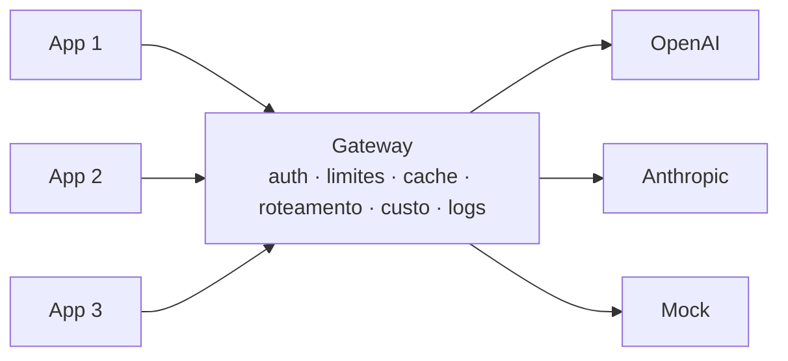

# 03 — O que é um LLM gateway

> **Épicos:** todos. Este é o "porquê" do projeto inteiro visto como categoria de software.

---

## 1. O problema

Quando várias aplicações chamam provedores de LLM diretamente, cada uma reimplementa (ou esquece) as mesmas preocupações: chave do provedor, retry, fallback, controle de custo, cache, logs. O resultado é custo sem dono, chaves espalhadas e nenhuma visão do todo (CONTEXT.md §2).

## 2. Como funciona

Um **LLM gateway** (ou _AI gateway_) é um **proxy reverso especializado**: fica entre os clientes e os provedores, fala o mesmo protocolo que os provedores (aqui, o da OpenAI) e aplica uma **esteira** de políticas em cada chamada.

### 2.1 API gateway × LLM gateway

Um **API gateway** genérico (Kong, NGINX, AWS API Gateway, Envoy) já faz autenticação, rate limit, roteamento e logs. O que muda num gateway de LLM:

| Aspecto          | API gateway genérico    | LLM gateway                                                                |
| ---------------- | ----------------------- | -------------------------------------------------------------------------- |
| Unidade de custo | Requisição              | **Token**, com preço diferente por modelo e por direção                    |
| Rate limit       | Requisições/segundo     | Requisições **e tokens** por minuto                                        |
| Cache            | Por URL e headers (GET) | Por **conteúdo** do corpo (POST), inclusive por **sentido** (semântico)    |
| Roteamento       | Por caminho/host        | Por **alias de modelo**, com fallback entre provedores com APIs diferentes |
| Respostas        | Curtas                  | Longas e em **streaming**                                                  |
| Logs             | Metadados               | Metadados + **conteúdo** (prompts), com questões de PII                    |
| Qualidade        | Status HTTP             | A resposta pode ser `200` e estar **errada**, daí os evals                 |

### 2.2 As capacidades típicas

1. **Interface unificada:** um formato só para N provedores (padrão Adapter).
2. **Controle de acesso:** chaves próprias por cliente; as chaves dos provedores ficam centralizadas.
3. **Controle de consumo:** rate limit e orçamento por cliente.
4. **Economia:** cache exato e semântico.
5. **Confiabilidade:** retry, circuit breaker, fallback.
6. **Visibilidade:** custo, latência, erros e conteúdo pesquisável.
7. **Governança:** redação de PII, retenção, auditoria.

## 3. Analogia

É a **central telefônica de uma empresa**. Os funcionários não têm linhas diretas com as operadoras: discam um ramal, e a central escolhe a operadora mais barata ou a que está funcionando, bloqueia quem estourou a cota, grava o registro da ligação e manda a conta para o departamento certo. Se a operadora A cai, a central passa para a B sem o funcionário perceber.

## 4. Por que está nesta arquitetura

É o próprio sistema. Construir um gateway é um ótimo projeto de aprendizado porque ele obriga a lidar, num lugar só, com quase tudo de back-end moderno: HTTP e streaming, cache, concorrência, filas, eventos, bancos relacional, vetorial e de busca, resiliência, observabilidade e testes de carga.

## 5. Ferramentas similares (produtos de mercado)

| Ferramenta                | Tipo                                  | Diferença principal                                                                     |
| ------------------------- | ------------------------------------- | --------------------------------------------------------------------------------------- |
| **LiteLLM**               | Open source (Python), SDK + proxy     | O mais popular; suporta centenas de modelos, formato OpenAI, orçamento, chaves virtuais |
| **Portkey**               | SaaS + gateway open source            | Foco em roteamento, guardrails e observabilidade                                        |
| **Kong AI Gateway**       | Plugins sobre o Kong                  | Para quem já usa Kong como API gateway                                                  |
| **Cloudflare AI Gateway** | Serviço gerenciado na edge            | Cache, rate limit e analytics sem infraestrutura própria                                |
| **Envoy AI Gateway**      | Open source sobre o Envoy             | Voltado para Kubernetes e service mesh                                                  |
| **OpenRouter**            | Marketplace hospedado                 | Uma chave para muitos modelos; ele é o intermediário de cobrança                        |
| **Helicone, Langfuse**    | Observabilidade de LLM (proxy ou SDK) | Foco em logs, custo e traces de chamadas, menos em controle                             |

O Portunus faz, em escala de estudo, o que LiteLLM e Portkey fazem. Ler a documentação deles é um ótimo jeito de ver decisões reais (como nomeiam headers, como calculam orçamento etc.).

## 6. Armadilhas

- **O gateway vira ponto único de falha.** Se ele cai, todos os apps caem. Daí a obsessão com "inferência primeiro": nada secundário pode derrubá-lo.
- **Latência adicionada.** Cada etapa da esteira soma milissegundos. A meta de overhead (p95 < 20 ms) existe para manter isso honesto.
- **Abstração vazada.** Provedores têm recursos que não existem nos outros. Um formato comum sempre perde algo; decida conscientemente o que não suportar.
- **Segurança concentrada.** O gateway guarda todas as chaves e todo o conteúdo. É um alvo valioso.

## 7. No Portunus

A esteira (CLAUDE.md, invariante 2): `auth → rate limit → orçamento → cache exato → cache semântico → router/provedor → custo → resposta → evento`. Cada etapa tem um documento nesta pasta.

## 8. Para aprofundar

- LiteLLM — docs do proxy: https://docs.litellm.ai/docs/simple_proxy
- Portkey — AI Gateway (open source): https://github.com/Portkey-AI/gateway
- Cloudflare AI Gateway: https://developers.cloudflare.com/ai-gateway/
- Chris Richardson — _API Gateway pattern_: https://microservices.io/patterns/apigateway.html
