# 04 — Streaming e Server-Sent Events (SSE)

> **Épicos:** E1 (mock com stream), E5 (streaming no gateway), E7 (fallback antes do primeiro byte), E9 (replay de cache em stream).
> **Módulos:** `inference`, `providers`, `resilience`.

---

## 1. O problema

Um LLM pode levar 10, 20 ou 30 segundos para gerar uma resposta longa. Se o usuário só vê algo no final, a experiência é ruim, e conexões abertas por muito tempo sem tráfego podem ser cortadas por proxies. A solução é mandar o texto **à medida que é gerado**.

## 2. Como funciona

### 2.1 SSE em uma frase

SSE é um padrão (parte da especificação HTML) para o **servidor empurrar eventos ao cliente por uma resposta HTTP comum que nunca "termina" até o servidor decidir**. É unidirecional (servidor → cliente) e em texto puro.

### 2.2 O formato no fio

A resposta tem `Content-Type: text/event-stream`. O corpo é uma sequência de eventos separados por uma linha em branco:

```
data: {"choices":[{"delta":{"content":"O prazo"}}]}

data: {"choices":[{"delta":{"content":" é de 7 dias."}}]}

data: {"choices":[],"usage":{"prompt_tokens":25,"completion_tokens":9}}

data: [DONE]

```

Campos possíveis por evento: `data:` (conteúdo), `event:` (nome do evento; a Anthropic usa isso), `id:` (para retomada) e `retry:` (sugestão de reconexão). Uma linha começando com `:` é um comentário, usado como **heartbeat** para manter a conexão viva.

No formato OpenAI:

- Cada chunk tem um `delta` (o pedaço novo), não a mensagem inteira.
- O stream termina com `data: [DONE]`.
- O `usage` só vem no final, e só se a requisição pedir `stream_options: { "include_usage": true }`.

### 2.3 Por baixo: HTTP chunked e backpressure

No HTTP/1.1, a resposta usa `Transfer-Encoding: chunked`: o servidor envia pedaços sem saber o tamanho total. No Node, a resposta é um **stream gravável**: se o cliente lê devagar, os buffers enchem e `write()` sinaliza que é preciso esperar (**backpressure**). Ignorar isso faz o gateway acumular memória quando o provedor é rápido e o cliente é lento.

### 2.4 O gateway como "cano"

```mermaid
sequenceDiagram
    participant C as Cliente
    participant G as Gateway
    participant P as Provedor
    C->>G: POST stream=true
    G->>P: POST stream=true
    P-->>G: chunk 1
    G-->>C: chunk 1 (repasse imediato)
    P-->>G: chunk 2
    G-->>C: chunk 2
    P-->>G: chunk final com usage + [DONE]
    G-->>C: chunk final + [DONE]
    Note over G: calcula custo, grava cache, publica evento
```



### 2.5 O momento do primeiro byte

Antes do primeiro byte enviado ao cliente, o gateway ainda pode mudar tudo: status HTTP, headers, até o provedor (fallback). **Depois**, os headers já foram enviados com `200 OK`; não é possível voltar atrás. Por isso:

- **Fallback só antes do primeiro byte** (invariante 8, ADR 007). Trocar de provedor no meio misturaria duas respostas diferentes.
- **Erro no meio do stream** vira um evento de erro dentro do próprio stream, e não um status HTTP.
- **Custo não cabe em header** num stream (ele só é conhecido no fim); vai no evento de uso e, se quiser, num chunk final.

### 2.6 Cancelamento

Se o cliente fecha a conexão, o gateway deve **abortar a chamada ao provedor** (com `AbortController`). Senão continua pagando tokens que ninguém vai ler.

## 3. Analogia

É a diferença entre **receber uma carta** e **ouvir alguém ditar ao telefone**. Com a carta, você espera até tudo estar escrito. No telefone, você ouve frase a frase. E, se a ligação cai no meio, não dá para "trocar de pessoa" e continuar a frase de onde parou: você recomeça ou aceita a frase incompleta.

## 4. Por que está nesta arquitetura

- Requisito de produto (CONTEXT.md §4.1): streaming como a OpenAI.
- Reduz a latência **percebida**: o TTFT importa mais que o tempo total.
- Obriga o gateway a separar "o que pode acontecer antes de responder" do "que acontece depois", uma distinção que aparece em resiliência, cache e custo.

## 5. Ferramentas similares (formas de enviar dados em tempo real)

| Técnica | Direção | Diferença principal | Quando usar |
|---|---|---|---|
| **SSE** | Servidor → cliente | HTTP comum, texto, reconexão automática no `EventSource` do navegador | Streams de LLM, notificações, feeds |
| **WebSocket** | Bidirecional | Protocolo próprio após um *upgrade*; binário ou texto; mais complexo para proxies e balanceadores | Chat em tempo real, jogos, colaboração |
| **Long polling** | Servidor → cliente (simulado) | Cliente faz requisição, servidor segura até ter dado, cliente refaz | Ambientes legados sem SSE/WS |
| **HTTP/2 streaming / gRPC streaming** | Uni ou bidirecional | Binário (protobuf), multiplexado | Comunicação entre serviços |
| **WebTransport** | Bidirecional | Sobre HTTP/3 (QUIC); ainda pouco adotado | Casos de baixa latência no navegador |

A indústria de LLM padronizou SSE porque ele funciona sobre HTTP comum (passa por proxies e CDNs) e o fluxo é naturalmente unidirecional.

## 6. Armadilhas

- **Proxies que fazem buffer** (NGINX com `proxy_buffering on`) seguram os chunks e quebram o efeito de streaming. O header `X-Accel-Buffering: no` ajuda no NGINX.
- **Compressão** (gzip) pode acumular dados antes de enviar.
- **Timeout de inatividade** em balanceadores: use heartbeats (`: ping`) em gerações com pausas longas.
- **Parsing incremental:** um chunk de rede **não** é um evento SSE; um evento pode chegar partido em dois pacotes, ou dois eventos podem chegar juntos. Use um parser de linhas, não `split` ingênuo.
- **Vazamento de recursos:** stream que nunca fecha (cliente sumiu, provedor travou) precisa de timeout.
- `EventSource` do navegador só faz GET; os SDKs de LLM usam `fetch` com leitura do corpo em stream.

## 7. No Portunus

- E1: o mock gera streams e simula falha no meio.
- E5: repasse, cálculo de custo no fim, cancelamento, backpressure.
- E7: timeout até o primeiro byte e fallback só antes dele.
- E9: grava a resposta completa ao fim e, num hit, "reproduz" como stream.

## 8. Para aprofundar

- WHATWG — especificação de Server-Sent Events: https://html.spec.whatwg.org/multipage/server-sent-events.html
- MDN — *Using server-sent events*: https://developer.mozilla.org/en-US/docs/Web/API/Server-sent_events/Using_server-sent_events
- OpenAI — streaming: https://platform.openai.com/docs/api-reference/chat-streaming
- Node.js — *Backpressuring in Streams*: https://nodejs.org/en/learn/modules/backpressuring-in-streams
