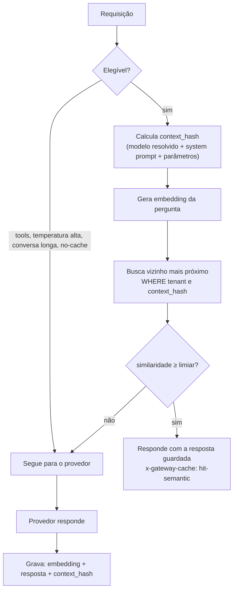

# 07 — Cache semântico

> **Épicos:** E10.
> **Módulos:** `cache`.
> **Pré-requisitos:** [05 Embeddings](./05-embeddings.md), [06 Busca vetorial](./06-busca-vetorial-e-pgvector.md), [15 Cache exato](./15-cache-exato.md).

---

## 1. O problema

O cache exato só acerta quando a pergunta é idêntica byte a byte. Usuários reais escrevem a mesma dúvida de muitas formas ("Qual o prazo de reembolso?", "em quantos dias consigo reembolso?", "reembolso demora quanto?"). Cada variação paga o provedor de novo.

## 2. Como funciona

### 2.1 O fluxo



### 2.2 Duas partes da "chave"

O cache semântico tem uma parte **exata** e uma parte **aproximada**:

- **Exata (escopo):** tenant, modelo resolvido, hash do system prompt e dos parâmetros que mudam a saída. Duas perguntas com system prompts diferentes **nunca** compartilham resposta, mesmo que a pergunta seja idêntica.
- **Aproximada:** o embedding da pergunta do usuário, comparado por similaridade.

### 2.3 O limiar (threshold)

O limiar define quão parecido precisa ser. É um trade-off direto:

| Limiar | Hit rate | Risco |
|---|---|---|
| Baixo (ex.: 0,85) | Alto | **Falsos positivos**: responder a pergunta errada |
| Alto (ex.: 0,97) | Baixo | Quase um cache exato; pouca economia |

O padrão do projeto é `0.92` *(a validar)*. A calibração é feita com uma suíte de pares:

- **Paráfrases verdadeiras** (deveriam dar hit).
- **"Parecidas mas diferentes"** (deveriam dar miss): "reembolso em 7 dias?" × "reembolso em 30 dias?", "como cancelo?" × "como não ser cancelado?".

Com isso se mede precisão e recall para cada limiar e se escolhe conscientemente.

### 2.4 Quando não usar

- **`tools` / function calling:** a resposta depende do resultado de funções externas.
- **Temperatura alta:** o cliente pediu respostas variadas; devolver sempre a mesma contraria o pedido.
- **Conversas longas:** o sentido depende de todo o histórico; comparar só a última mensagem é perigoso.
- **Dados que mudam com o tempo:** "qual a cotação do dólar hoje?".
- **Pedido explícito:** `x-gateway-cache-control: no-cache`.

### 2.5 Custo/benefício

```
economia = taxa_de_hit × custo_médio_da_chamada
custo    = custo_do_embedding (em todo candidato) + latência_extra_em_todo_miss
```

Se a taxa de hit for baixa, o cache semântico **piora** custo e latência. Por isso as métricas obrigatórias: hit rate, economia em USD e similaridade média dos hits.

## 3. Analogia

É um **atendente de SAC experiente**. Quando alguém pergunta "em quantos dias sai meu reembolso?", ele lembra que já respondeu "qual o prazo de reembolso?" mais cedo e repete a resposta, sem consultar o manual. O risco é o atendente apressado que ouve "reembolso de passagem internacional" e responde com a regra da nacional, porque "parecia a mesma pergunta". O limiar é o quanto ele presta atenção antes de reaproveitar.

## 4. Por que está nesta arquitetura

- É uma das capacidades que diferenciam um **LLM gateway** de um API gateway comum.
- Ataca diretamente a dor "pagar várias vezes pela mesma coisa" (CONTEXT.md §2).
- É um excelente exercício de AI Engineering: unir embeddings, banco vetorial, métricas de qualidade e trade-offs de produto.

## 5. Ferramentas similares

| Ferramenta | Diferença principal |
|---|---|
| **GPTCache** (Zilliz) | Biblioteca Python dedicada a cache semântico, com vários backends vetoriais |
| **Redis LangCache / RedisVL** | Cache semântico sobre o Redis, com busca vetorial em memória |
| **LiteLLM / Portkey** | Gateways com cache semântico embutido (Redis ou Qdrant como backend) |
| **Prompt caching dos provedores** (OpenAI, Anthropic) | **Não é cache semântico:** reaproveita o processamento de um **prefixo idêntico** dentro do provedor; reduz custo de entrada, mas a resposta é gerada de novo |

## 6. Armadilhas

- **Falso positivo é pior que miss.** Um miss custa dinheiro; um falso positivo entrega uma resposta errada com cara de certa, e ninguém percebe.
- **Vazamento entre tenants** se o filtro por tenant falhar: é um incidente de privacidade, não um bug de cache.
- **Respostas personalizadas** ("seu pedido 123 está a caminho") nunca deveriam ir para o cache semântico.
- **Envelhecimento:** respostas guardadas ficam desatualizadas; precisa de TTL e expurgo.
- **Similaridade entre modelos de embedding** não é comparável (limiar recalibrado ao trocar de modelo).
- **Testes com mock** não exercitam a semântica (ver [05](./05-embeddings.md), seção 6).

## 7. No Portunus

- E10: elegibilidade, `context_hash`, busca, limiar por tenant/alias, contador de hits, expurgo, métricas e suíte de calibração.
- Ordem na esteira: **depois** do cache exato (que é mais barato) e **antes** do router.

## 8. Para aprofundar

- GPTCache: https://github.com/zilliztech/GPTCache
- Redis — *Semantic caching for LLMs*: https://redis.io/docs/latest/develop/ai/redisvl/user_guide/llmcache/
- OpenAI — *Prompt caching* (para entender a diferença): https://platform.openai.com/docs/guides/prompt-caching
- Anthropic — *Prompt caching*: https://docs.anthropic.com/en/docs/build-with-claude/prompt-caching
