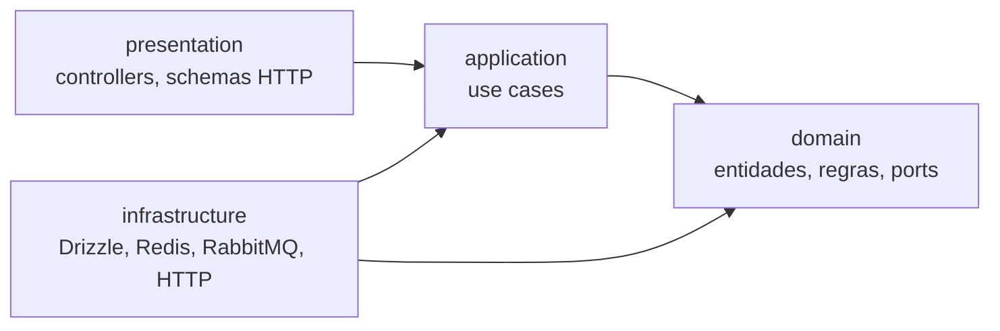

# 11 — Clean Architecture e design patterns

> **Épicos:** todos.
> **Onde:** `apps/gateway/src/modules/<modulo>/{domain,application,infrastructure,presentation}`.

---

## 1. O problema

Código em que a regra de negócio ("o custo é tokens × preço vigente") está misturada com detalhes técnicos (a query do Drizzle, a chamada HTTP, o formato da resposta do Fastify) é difícil de testar, difícil de entender e difícil de trocar. Para testar o cálculo de custo, seria preciso subir um banco. Para trocar o Redis por outra coisa, seria preciso reescrever a regra.

## 2. Como funciona

### 2.1 A regra de dependência

A **Clean Architecture** (Robert C. Martin) organiza o código em círculos concêntricos. **As dependências só apontam para dentro**: o centro não sabe que o resto existe.



| Camada | Contém | Pode importar |
|---|---|---|
| `domain/` | Entidades, value objects, regras puras, **ports** (interfaces) | Nada de infraestrutura nem de framework |
| `application/` | **Use cases**: orquestram o domínio por meio dos ports | Só `domain/` |
| `infrastructure/` | **Adapters**: implementam os ports com tecnologias reais | `domain/`, `application/` e bibliotecas |
| `presentation/` | Controllers, schemas de request/response | `application/` |

### 2.2 Ports and adapters (arquitetura hexagonal)

A ideia de Alistair Cockburn, base da Clean Architecture:

- **Port:** uma interface definida pelo **domínio**, na linguagem do domínio. Ex.: `ExactCachePort { get(key): Promise<CachedResponse | null> }`.
- **Adapter:** uma implementação concreta na infraestrutura. Ex.: `RedisExactCacheAdapter`.
- **Inversão de dependência (o "D" do SOLID):** o use case depende da **abstração**; quem liga a abstração à implementação é o módulo do Nest (DI).

Ganho direto: o use case é testado com um fake em memória, em milissegundos, sem Docker.

### 2.3 Os padrões que o projeto pede

| Padrão | Problema que resolve | Onde aparece |
|---|---|---|
| **Adapter** | Interfaces incompatíveis (cada provedor tem sua API) | `OpenAIAdapter`, `AnthropicAdapter`, `MockAdapter` atrás do port `LlmProvider` |
| **Strategy** | Trocar um algoritmo sem mudar quem o usa | Algoritmo de rate limit; critérios de eval |
| **Chain of Responsibility / Pipeline** | Uma sequência de etapas, cada uma pode encerrar ou passar adiante | A esteira: auth → limite → cache → router |
| **Repository** | Esconder o acesso a dados atrás de uma coleção do domínio | `TenantRepository`, `SemanticCacheRepository` |
| **Circuit Breaker** | Parar de chamar um serviço que está falhando | Módulo `resilience` ([18](./18-resiliencia.md)) |
| **Outbox** | Publicar eventos de forma confiável | Módulo `events` ([21](./21-outbox-e-idempotencia.md)) |
| **Value Object** | Um valor com regras próprias e sem identidade | `Money`, `ApiKeyHash`, `CacheKey` |

A regra do CLAUDE.md: use um padrão **quando ele resolver um problema real**, e diga qual é e por quê.

### 2.4 Value objects e regras puras

```ts
export class Money {
  private constructor(private readonly microUsd: bigint) {}
  static fromMicroUsd(value: bigint): Money { ... }
  add(other: Money): Money { ... }
}
```

Regras no domínio são **funções puras** sempre que possível: mesma entrada, mesma saída, sem I/O. Elas são o alvo ideal de TDD.

## 3. Analogia

Pense numa **tomada elétrica**. O aparelho (o domínio) foi projetado para um **padrão de tomada** (o port). Ele não sabe se a energia vem de hidrelétrica, solar ou de um gerador a diesel (os adapters). Se você viaja para outro país, usa um **adaptador** de tomada: o aparelho continua igual. E, para testar o aparelho na fábrica, você o liga numa fonte de bancada (o fake), sem precisar de uma usina.

## 4. Por que está nesta arquitetura

- **Testabilidade:** as regras mais importantes (custo, chave de cache, limite, circuit breaker) rodam sem infraestrutura.
- **Troca de tecnologia:** pgvector × Qdrant, Redis × Valkey, RabbitMQ × outra fila. A troca afeta só o adapter.
- **Reuso:** o worker assíncrono (E14) chama os **mesmos use cases** da rota síncrona.
- **Aprendizado:** separar "o que o sistema faz" de "com que ferramenta" é uma habilidade central de um dev pleno.

## 5. Abordagens similares

| Abordagem | Diferença |
|---|---|
| **Hexagonal (ports and adapters)** | A origem da ideia; foca em "dentro × fora" sem prescrever camadas |
| **Onion Architecture** (Jeffrey Palermo) | Mesma regra de dependência, com nomes de camadas diferentes |
| **Arquitetura em camadas tradicional** (controller → service → repository) | Mais simples; o service costuma depender diretamente do ORM, então o domínio fica acoplado à infraestrutura |
| **Vertical slices** | Organiza por feature (tudo de "criar chave" junto) em vez de por camada; menos cerimônia |
| **DDD (Domain-Driven Design)** | Complementar: fala de modelagem (agregados, contextos delimitados, linguagem ubíqua), não só de camadas |

## 6. Armadilhas

- **Cerimônia demais:** port com uma implementação só e nenhum teste que a substitua é burocracia. Pergunte "o que isso me compra?".
- **Domínio anêmico:** entidades sem comportamento e toda a lógica nos use cases; acaba sendo um "service" com outro nome.
- **Vazamento de infraestrutura no domínio:** um tipo do Drizzle ou do ioredis aparecendo numa assinatura do domínio quebra a regra de dependência sem ninguém notar. Um lint de import (regra de fronteiras) ajuda.
- **Mapeamentos em excesso:** converter entre objeto do banco, entidade e DTO em cada camada tem custo; mapeie onde há diferença real.

## 7. No Portunus

- Estrutura de pastas por módulo descrita no CLAUDE.md §1.
- Ligação port → adapter no `<modulo>.module.ts`.
- Use cases com nomes de intenção: `lookup-cache.use-case.ts`, `resolve-alias.use-case.ts`.

## 8. Para aprofundar

- Robert C. Martin — *The Clean Architecture*: https://blog.cleancoder.com/uncle-bob/2012/08/13/the-clean-architecture.html
- Alistair Cockburn — *Hexagonal Architecture*: https://alistair.cockburn.us/hexagonal-architecture/
- Refactoring.Guru — catálogo de design patterns: https://refactoring.guru/design-patterns
- Livro: *Clean Architecture* (Robert C. Martin) e *Domain-Driven Design Distilled* (Vaughn Vernon)
