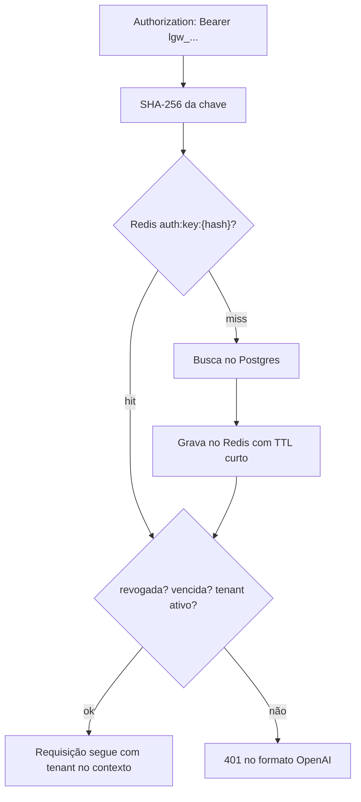

# 16 — API keys, autenticação e multi-tenancy

> **Épicos:** E2.
> **Módulos:** `auth`, `tenants`, `admin`.

---

## 1. O problema

O gateway atende vários clientes (tenants). Ele precisa saber **quem** está chamando, recusar quem não tem permissão e garantir que um cliente **nunca** veja dados, cache ou limites de outro. Além disso, se o banco vazar, as chaves dos clientes não podem ser reaproveitadas pelo atacante.

## 2. Como funciona

### 2.1 Autenticação × autorização

- **Autenticação (AuthN):** quem é você? → a chave identifica o tenant.
- **Autorização (AuthZ):** o que você pode fazer? → políticas do tenant (limites, modelos permitidos, admin ou não).

### 2.2 Anatomia de uma API key

```
lgw_live_8f3KxQ2...   (prefixo visível)  +  segredo aleatório (ex.: 32 bytes em base62)
```

- **Alta entropia:** 32 bytes aleatórios (256 bits) de um gerador criptográfico (`crypto.randomBytes`). Adivinhar é impossível na prática.
- **Prefixo identificável:** permite saber de onde a chave veio num log ou num vazamento, e habilita ferramentas de *secret scanning* (o GitHub detecta prefixos registrados).
- **Exibida uma única vez:** o gateway guarda apenas o **hash**.

### 2.3 Por que SHA-256, e não bcrypt?

| Segredo | Entropia | Hash adequado | Motivo |
|---|---|---|---|
| **Senha humana** | Baixa ("Senha@123") | **bcrypt / scrypt / argon2** (lentos de propósito) | Lentidão impede ataque de força bruta com dicionário |
| **API key aleatória** | Altíssima (256 bits) | **SHA-256** (rápido) | Força bruta é inviável mesmo com hash rápido; e o hash é calculado em **toda requisição**, então precisa ser barato |

Com SHA-256, a busca é direta: `hash(chave_recebida)` → procurar esse hash no Redis/Postgres. Com bcrypt, isso seria impossível (cada hash tem um *salt* diferente) e lento.

### 2.4 Fluxo de autenticação



- **TTL curto no cache** = janela em que uma chave revogada ainda funciona. Solução: na revogação, apagar a entrada do Redis (invalidação ativa) além do TTL.
- **Último uso:** atualizar a cada requisição seria uma escrita no Postgres por chamada. Use *throttle* (no máximo uma vez por minuto por chave) e fora do caminho crítico.

### 2.5 Credencial de admin separada

Rotas de administração (criar tenant, emitir chave) usam outra credencial. Uma chave de tenant vazada nunca dá acesso administrativo (princípio do menor privilégio).

### 2.6 Multi-tenancy: modelos de isolamento

| Modelo | Como | Prós | Contras |
|---|---|---|---|
| **Banco compartilhado, coluna `tenant_id`** | Toda tabela tem `tenant_id` | Simples, barato, escala bem | Isolamento depende de **toda query** filtrar |
| **Schema por tenant** | Um schema Postgres por cliente | Isolamento melhor | Migrations N vezes |
| **Banco por tenant** | Uma instância por cliente | Isolamento máximo | Caro e complexo |

O projeto usa **coluna `tenant_id`** e aplica o tenant em tudo: queries, chaves de Redis, entradas de cache, métricas e índices de busca. **Row Level Security** do Postgres pode reforçar no banco.

## 3. Analogia

- A **API key** é o **crachá** de um prédio comercial. A portaria não guarda uma cópia do crachá; guarda uma "impressão" dele (o hash). Se alguém roubar a lista de impressões, não consegue fabricar crachás.
- O **prefixo** é o logotipo da empresa impresso no crachá: identifica a origem sem revelar o segredo.
- **Multi-tenancy** é o prédio com várias empresas: elevador, portaria e garagem são compartilhados, mas cada empresa só abre as próprias salas. Um erro na fechadura de uma sala é um incidente grave, não um "bug pequeno".

## 4. Por que está nesta arquitetura

- É a primeira etapa da esteira: nada acontece sem identificar o tenant.
- O tenant é o "eixo" de custo, limites, cache e privacidade.
- Centraliza as chaves dos provedores: os clientes nunca as veem (CONTEXT.md §4.2).

## 5. Ferramentas similares (mecanismos de autenticação)

| Mecanismo | Diferença principal | Quando usar |
|---|---|---|
| **API key (opaca)** | Simples; validação por consulta | **APIs máquina-a-máquina**, como a da OpenAI. Escolha do projeto |
| **JWT** | Token autocontido e assinado; validação sem consulta | Sessões de usuário, microserviços; revogação é difícil (precisa de lista de bloqueio ou expiração curta) |
| **OAuth 2.0 (client credentials)** | Troca credenciais por tokens de curta duração | Integrações entre empresas, escopos finos |
| **mTLS** | Certificado do cliente na conexão TLS | Comunicação interna de alta segurança |
| **HMAC por requisição** (estilo AWS SigV4) | Cada requisição é assinada; o segredo nunca trafega | APIs de alto risco |
| **Provedores gerenciados** (Unkey, Auth0, Kong) | API keys como serviço | Não quer construir |

Compatibilidade com o SDK da OpenAI exige `Authorization: Bearer <chave>`, ou seja, API key opaca.

## 6. Armadilhas

- **Comparação de strings com `===`** pode vazar informação por tempo (*timing attack*). Com busca por hash isso é mitigado, mas em comparações diretas use `crypto.timingSafeEqual`.
- **Logar a chave** (inclusive em erros). Logue só o prefixo.
- **Chave na URL** (`?api_key=`) fica em logs de proxies. Só em header.
- **Cache negativo:** guardar "chave inválida" no Redis evita martelar o Postgres com chaves falsas, mas precisa de TTL curto.
- **Esquecer o tenant numa query** = vazamento entre clientes. Repositórios que **exigem** o `tenantId` como parâmetro ajudam.
- **Chaves sem expiração nem rotação.**

## 7. No Portunus

- E2: tabelas `tenants` e `api_keys`, geração, hash, guard, cache no Redis, revogação, credencial de admin.
- O tenant identificado vira parte do contexto da requisição e é usado por todas as etapas seguintes.

## 8. Para aprofundar

- OWASP — *Authentication Cheat Sheet*: https://cheatsheetseries.owasp.org/cheatsheets/Authentication_Cheat_Sheet.html
- OWASP — *Password Storage Cheat Sheet* (para entender o contraste com senhas): https://cheatsheetseries.owasp.org/cheatsheets/Password_Storage_Cheat_Sheet.html
- GitHub — *About secret scanning*: https://docs.github.com/en/code-security/secret-scanning/about-secret-scanning
- AWS — *SaaS tenant isolation strategies* (whitepaper)
