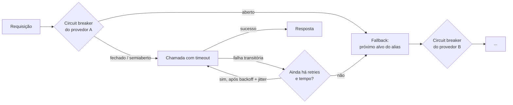
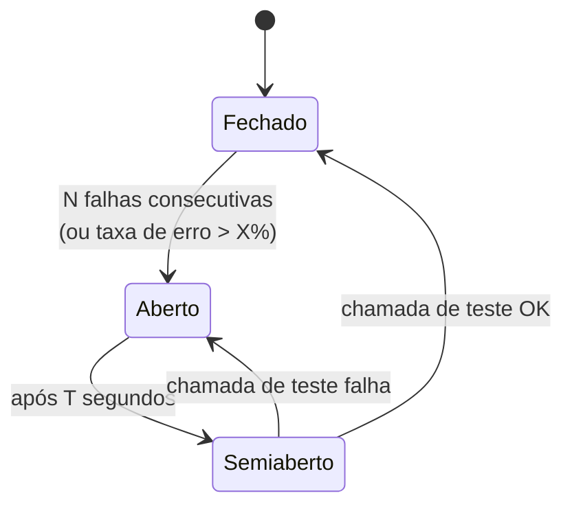

# 18 — Resiliência: timeout, retry, circuit breaker e fallback

> **Épicos:** E7.
> **Módulos:** `resilience`, `routing`, `providers`.
> **ADRs:** 007 (fallback só antes do primeiro byte); circuit breaker distribuído × local.

---

## 1. O problema

Provedores de LLM falham com frequência: `429` por sobrecarga, `5xx`, timeouts, lentidão extrema. Se o gateway simplesmente repassar a falha, o produto do cliente para. Se ele insistir de forma ingênua, piora a situação do provedor e deixa o cliente esperando para sempre.

## 2. Como funciona

São quatro mecanismos que trabalham juntos, em camadas:



### 2.1 Timeout

Toda chamada externa precisa de um limite de tempo. Sem isso, uma conexão travada prende recursos indefinidamente.

- **Timeout de conexão:** quanto esperar para conectar.
- **Tempo até o primeiro byte (TTFB):** essencial em streaming. O provedor aceitou, mas não começou a responder.
- **Timeout total:** limite para a operação inteira, **incluindo todas as tentativas** (um *budget* de tempo). Sem ele, 3 retries × 30 s = 90 s de espera.

Em Node: `AbortController` + `AbortSignal.timeout(ms)`.

### 2.2 Retry com backoff exponencial e jitter

Repetir só faz sentido para erros **transitórios**:

| Repetir | Não repetir |
|---|---|
| `429`, `500`, `502`, `503`, `504`, timeout, conexão recusada | `400`, `401`, `403`, `404`, `422` (o erro é do pedido, e vai falhar igual) |

**Backoff exponencial:** esperar cada vez mais entre tentativas: `base × 2^tentativa` (100 ms, 200 ms, 400 ms...), com um teto (`cap`).

**Jitter:** adicionar aleatoriedade. Sem jitter, mil clientes que falharam juntos tentam de novo **juntos**, criando ondas sincronizadas (*thundering herd*). O "full jitter" recomendado pela AWS:

```
espera = random(0, min(cap, base × 2^tentativa))
```

**Respeitar `Retry-After`:** se o provedor diz "tente em 5 s", esperar menos é desperdício e mais é latência inútil.

**Idempotência:** retry só é seguro se repetir não causa efeito duplicado. Uma chamada de chat não altera estado no provedor, mas pode **cobrar duas vezes** se a primeira chegou a ser processada (timeout no meio). É um custo aceito, mas precisa estar registrado em `attempts[]`.

### 2.3 Circuit breaker

Se um provedor está claramente fora do ar, continuar tentando só adiciona latência a toda requisição e sobrecarrega quem já está mal. O circuit breaker é uma **máquina de estados** por provedor:



- **Fechado:** tudo passa; falhas são contadas.
- **Aberto:** nada passa; falha imediata (*fail fast*), e o router vai direto para o fallback.
- **Semiaberto:** deixa passar uma (ou poucas) requisição de teste.

**Distribuído (Redis) × local (memória):** com estado no Redis (`cb:{provider}`), todas as instâncias abrem juntas e aprendem juntas; o custo é uma ida ao Redis por chamada e o cuidado com race conditions (várias instâncias querendo ser "a que testa" no semiaberto). Local é mais simples e rápido, mas cada instância precisa "descobrir" a falha sozinha.

### 2.4 Fallback

Quando as tentativas num alvo se esgotam (ou o circuito está aberto), passar ao **próximo alvo** da lista do alias: `inteligente → [Anthropic modelo X, OpenAI modelo Y]`. Todas as tentativas ficam em `attempts[]` para auditoria.

**Streaming:** fallback **só antes do primeiro byte** enviado ao cliente (invariante 8). Depois disso, falha vira evento de erro no stream ([04](./04-streaming-e-sse.md)).

### 2.5 Outros padrões da família

- **Bulkhead:** isolar recursos (ex.: pool de conexões por provedor) para que um provedor lento não consuma todas as conexões.
- **Hedging:** disparar uma segunda chamada se a primeira demora além do p95, e usar a que responder primeiro. Reduz a latência de cauda, mas dobra o custo. Raramente vale a pena para LLM.
- **Load shedding:** recusar trabalho cedo quando o sistema está saturado.

## 3. Analogia

- **Timeout:** você liga para uma loja e decide que, se ninguém atender em 30 segundos, desliga.
- **Retry com backoff e jitter:** deu ocupado? Você tenta de novo em 1 minuto, depois em 2, depois em 4, e cada pessoa da fila espera um tempo um pouco diferente, para não ligarem todas no mesmo segundo.
- **Circuit breaker:** é o **disjuntor de casa**. Se há um curto-circuito, ele desarma e para de mandar energia para aquele circuito, protegendo o resto da casa. Depois de um tempo, você religa para testar; se der curto de novo, desarma outra vez.
- **Fallback:** a loja não atende, então você liga para a filial.

## 4. Por que está nesta arquitetura

- Requisito direto (CONTEXT.md §4.4): falhas transparentes para o cliente.
- Demo de portfólio: "provedor caindo sem o cliente perceber".
- É um dos temas mais clássicos de sistemas distribuídos e de entrevistas de nível pleno/sênior.

## 5. Ferramentas similares

| Ferramenta | Plataforma | Diferença |
|---|---|---|
| **opossum** | Node | Circuit breaker popular, em memória |
| **cockatiel** | Node/TS | Retry, circuit breaker, timeout, bulkhead e fallback compostos como políticas; inspirado no Polly |
| **resilience4j** | Java | Referência na JVM; sucessor do Hystrix |
| **Polly** | .NET | Referência em .NET |
| **Hystrix** (Netflix) | Java | Pioneiro, hoje em modo de manutenção |
| **Envoy / Istio** | Service mesh | Retry, timeout e *outlier detection* na infraestrutura, sem código |

O projeto implementa à mão no domínio (máquina de estados testada com TDD), o que é ideal para aprender. Em produção, cockatiel seria uma boa referência para comparar.

## 6. Armadilhas

- **Retry storm:** retries em várias camadas (SDK do cliente + gateway + provedor) se multiplicam: 3 × 3 × 3 = 27 chamadas por requisição original.
- **Retry em erro do cliente** (`400`) só gasta dinheiro.
- **Timeout total ignorado:** a soma das tentativas estoura o que o cliente aceita esperar.
- **Circuit breaker sensível demais** abre com poucas falhas em baixo volume; use também um mínimo de requisições na janela.
- **Fallback para um modelo muito diferente** muda a qualidade da resposta. Isso precisa ser visível (header de provedor, `attempts[]`).
- **Testar resiliência sem um mock que falha de propósito** é impossível; daí o E1.

## 7. No Portunus

- E7: timeouts por alias, retry com full jitter e `Retry-After`, circuit breaker no Redis, fallback, `attempts[]`, `502/503` quando tudo falha, métrica `gateway_circuit_state{provider}`, dashboard "Provedores".

## 8. Para aprofundar

- AWS Architecture Blog — *Exponential Backoff And Jitter*: https://aws.amazon.com/blogs/architecture/exponential-backoff-and-jitter/
- Martin Fowler — *CircuitBreaker*: https://martinfowler.com/bliki/CircuitBreaker.html
- Amazon Builders' Library — *Timeouts, retries, and backoff with jitter*: https://aws.amazon.com/builders-library/timeouts-retries-and-backoff-with-jitter/
- Livro: *Release It!* (Michael Nygard), que popularizou o circuit breaker
