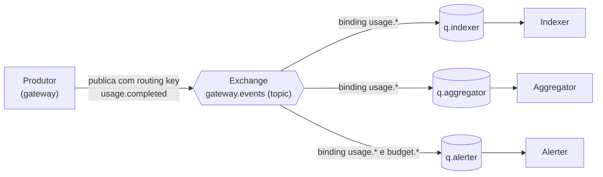

# 20 — Mensageria e RabbitMQ

> **Épicos:** E11 (eventos de uso), E12 e E13 (consumidores).
> **Onde:** módulo `events` do gateway (publicação), `apps/consumers` (consumo), `libs/events` (contratos).
> **ADRs:** 002 (BullMQ para jobs, RabbitMQ para eventos), 009 (consumidores em processo separado).

---

## 1. O problema

Ao fim de cada chamada, várias coisas precisam acontecer: indexar no Elasticsearch, somar custo no Postgres, checar alertas. Se o gateway fizer tudo isso **antes** de responder, fica lento; se uma delas falhar (Elasticsearch fora), a resposta falha junto. Se fizer **depois** em memória, perde tudo quando o processo reinicia. E, a cada nova necessidade, o gateway teria que ser alterado.

## 2. Como funciona

### 2.1 Mensageria em uma frase

Um **message broker** recebe mensagens de **produtores**, guarda com segurança e as entrega a **consumidores**, desacoplando os dois no **tempo** (o consumidor pode estar fora do ar), no **espaço** (um não conhece o endereço do outro) e na **escala** (cada lado escala separadamente).

### 2.2 O modelo do RabbitMQ (AMQP 0-9-1)

- **Produtor:** publica numa **exchange**, nunca diretamente numa fila.
- **Exchange:** decide para quais filas copiar a mensagem, com base no tipo e nas **bindings**.
- **Binding:** regra "fila X recebe mensagens da exchange Y com o padrão Z".
- **Fila (queue):** armazena as mensagens até um consumidor confirmar.
- **Consumidor:** lê da fila e confirma (*ack*).

**Tipos de exchange:**

| Tipo | Roteia por | Exemplo |
|---|---|---|
| **direct** | Routing key exata | `usage.completed` → fila de usage |
| **fanout** | Ignora a key; copia para todas as filas ligadas | Broadcast |
| **topic** | Padrão com curingas (`*` uma palavra, `#` zero ou mais) | `usage.*`, `budget.#` — **o tipo usado no projeto** |
| **headers** | Atributos nos headers | Roteamento por metadados |

### 2.3 Garantias de entrega

- **Mensagens persistentes + filas duráveis:** sobrevivem a reinício do broker.
- **Publisher confirms:** o broker confirma ao produtor que **recebeu e guardou** a mensagem. Sem isso, o produtor não sabe se ela se perdeu no caminho.
- **Consumer acks:** o consumidor confirma (`ack`) só **depois** de processar. Se cair antes, a mensagem volta para a fila e é reentregue. Isso é **at-least-once**: pode haver duplicata, daí a idempotência ([21](./21-outbox-e-idempotencia.md)).
- **Nack / reject:** devolve a mensagem (com ou sem reenfileirar).
- **Prefetch (`basic.qos`):** quantas mensagens não confirmadas um consumidor pode segurar ao mesmo tempo. Controla vazão e justiça entre consumidores.

### 2.4 Dead letter exchange (DLX) e DLQ

Uma mensagem que falha repetidamente (*poison message*) não pode travar a fila nem ser perdida. Com `x-dead-letter-exchange`, mensagens rejeitadas (ou expiradas, ou que excedem o tamanho da fila) vão para a exchange `gateway.dlx`, que as encaminha para `q.indexer.dlq`, por exemplo. Lá ficam para análise e reprocessamento.

Para retry com espera entre tentativas, um padrão comum é uma fila de "retry" com TTL que devolve a mensagem à fila original quando o TTL expira. Outra opção é o plugin de mensagens atrasadas.

### 2.5 Tipos de fila

- **Classic:** a tradicional.
- **Quorum queues:** replicadas com o algoritmo de consenso Raft; são as recomendadas para durabilidade em cluster.
- **Streams:** log append-only com releitura, parecido com Kafka.

### 2.6 Competing consumers

Várias instâncias do mesmo consumidor lendo a **mesma fila** dividem o trabalho (cada mensagem vai para uma delas). Para escalar o Indexer, basta subir mais instâncias. A ordem de processamento, porém, deixa de ser garantida.

## 3. Analogia

O RabbitMQ é os **Correios com uma central de triagem**. O gateway (remetente) não leva cada carta até o destinatário; deixa no balcão (exchange) com um CEP (routing key). A triagem (bindings) põe uma cópia na caixa postal de cada setor interessado (filas). Cada setor retira quando pode e assina o recibo (ack). Se o setor estiver fechado, as cartas esperam na caixa postal. Cartas que voltam sempre com problema vão para o setor de "cartas não entregues" (DLQ), em vez de sumirem.

## 4. Por que está nesta arquitetura

- **Inferência primeiro:** publicar é rápido e fora do caminho crítico; o trabalho pesado acontece depois, em outro processo.
- **Fan-out:** um evento de uso alimenta três consumidores independentes; adicionar um quarto não exige mudar o gateway.
- **Isolamento de falha:** o Elasticsearch fora do ar só acumula mensagens em `q.indexer`; o Aggregator segue normalmente.
- **Roteamento rico** (topic) e DLQ nativa.
- **ADR 002:** RabbitMQ para **eventos** (fan-out para vários consumidores) e BullMQ para **jobs** (uma tarefa, com retry, prioridade e resultado). A comparação está em [22](./22-filas-de-jobs-e-bullmq.md).

## 5. Ferramentas similares

| Ferramenta | Modelo | Diferença principal | Quando escolher |
|---|---|---|---|
| **RabbitMQ** | Broker de filas (*smart broker*) | Roteamento flexível, acks por mensagem, DLX; a mensagem some após o ack | Eventos e tarefas com roteamento; volume moderado a alto |
| **Apache Kafka** | **Log distribuído particionado** | Mensagens ficam retidas (dias/semanas); consumidores controlam o próprio *offset* e podem **reler**; ordem garantida por partição; throughput enorme | Streaming de eventos em grande escala, *event sourcing*, reprocessamento histórico |
| **Amazon SQS / SNS** | Fila / pub-sub gerenciados | Zero operação; SNS faz fan-out para várias SQS; *visibility timeout* em vez de ack | Na AWS e sem querer operar broker |
| **Google Pub/Sub, Azure Service Bus** | Gerenciados | Equivalentes nas outras nuvens | Na respectiva nuvem |
| **NATS / NATS JetStream** | Mensageria leve | Muito rápido e simples; JetStream adiciona persistência | Microserviços, IoT, edge |
| **Redis Streams** | Log no Redis | Grupos de consumidores e acks, sem um serviço novo | Já tem Redis e o volume é moderado |
| **Apache Pulsar** | Log + filas | Separa armazenamento (BookKeeper) do broker | Multi-tenant em grande escala |

**RabbitMQ × Kafka, a comparação mais importante:**

| | RabbitMQ | Kafka |
|---|---|---|
| Modelo mental | Caixa de correio: lida e removida | Livro-razão: lido por posição, nada é removido |
| Releitura | Não (após ack) | Sim, voltando o offset |
| Ordem | Por fila (perde-se com competing consumers) | Por partição |
| Roteamento | Rico (exchanges) | Por tópico/partição (lógica no consumidor) |
| Operação | Mais simples | Mais complexa (KRaft, partições, rebalanceamento) |

Para o volume e as necessidades do gateway (fan-out, DLQ, roteamento), o RabbitMQ é mais simples e suficiente.

## 6. Armadilhas

- **Publicar sem confirms** = perder mensagens silenciosamente.
- **Ack antes de processar** = perder a mensagem se o consumidor cair.
- **Reenfileirar infinitamente** uma poison message (`nack` com requeue) trava o consumidor em loop. Use contagem de tentativas e DLQ.
- **Fila crescendo sem limite** quando o consumidor está fora: monitore profundidade e configure limites/alertas.
- **Conexão × canal:** abra uma conexão por processo e canais por thread de trabalho; não abra uma conexão por mensagem.
- **Duplicatas** são normais (at-least-once). O consumidor **tem** que ser idempotente.
- **Propagação de trace:** o `trace_id` vai nos headers da mensagem para o consumidor continuar o mesmo trace ([29](./29-tracing-e-tempo.md)).

## 7. No Portunus

- E11: exchange `gateway.events` (topic); routing keys `usage.completed`, `usage.failed`, `budget.threshold`; filas `q.indexer`, `q.aggregator`, `q.alerter`; DLX `gateway.dlx`; confirms; `event_id` e `trace_id` nos headers; cliente `amqplib` (ou um wrapper).
- E12 e E13: os consumidores propriamente ditos.

## 8. Para aprofundar

- RabbitMQ — tutoriais (comece pelos 1 a 5): https://www.rabbitmq.com/tutorials
- RabbitMQ — *AMQP 0-9-1 Model Explained*: https://www.rabbitmq.com/tutorials/amqp-concepts
- RabbitMQ — *Dead Letter Exchanges*: https://www.rabbitmq.com/docs/dlx
- RabbitMQ — *Consumer Acknowledgements and Publisher Confirms*: https://www.rabbitmq.com/docs/confirms
- Livro: *Enterprise Integration Patterns* (Hohpe & Woolf): https://www.enterpriseintegrationpatterns.com/
