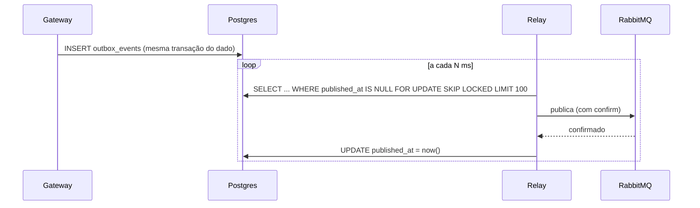

# 21 — Outbox, idempotência e garantias de entrega

> **Épicos:** E11 (outbox e relay), E12 e E13 (consumidores idempotentes), E14 (jobs).
> **Onde:** módulo `events`, tabela `outbox_events`, tabela `processed_events`.
> **ADR:** 005 (padrão outbox).

---

## 1. O problema

**O problema da escrita dupla (_dual write_):** o gateway precisa (a) responder/gravar algo e (b) publicar um evento no RabbitMQ. São dois sistemas diferentes, sem transação comum. Qualquer combinação de falhas gera inconsistência:

- Grava no banco e o RabbitMQ está fora → evento perdido.
- Publica e o processo cai antes de gravar → evento sobre algo que não existe.

Do outro lado, o broker entrega **at-least-once**: a mesma mensagem pode chegar duas vezes. Um Aggregator ingênuo somaria o custo em dobro.

## 2. Como funciona

### 2.1 Garantias de entrega

| Garantia          | Significado                             | Como se obtém                                                                               |
| ----------------- | --------------------------------------- | ------------------------------------------------------------------------------------------- |
| **At-most-once**  | Entrega 0 ou 1 vez (pode perder)        | Ack antes de processar; publicar sem confirmação                                            |
| **At-least-once** | Entrega 1 ou mais vezes (pode duplicar) | Ack depois de processar; retry na publicação                                                |
| **Exactly-once**  | Exatamente 1 vez                        | Em sistemas distribuídos, na prática: **at-least-once + idempotência** ("effectively once") |

### 2.2 O padrão Transactional Outbox

1. Na **mesma transação** do banco em que o dado de negócio é gravado, grava-se também o evento numa tabela `outbox_events`.
2. Um processo separado (**relay**) lê os eventos não publicados, publica no broker (com confirms) e marca `published_at`.
3. Se o broker estiver fora, os eventos esperam na tabela. Se o relay cair depois de publicar e antes de marcar, o evento é publicado de novo (duplicata, que o consumidor tolera).



- **`FOR UPDATE SKIP LOCKED`:** várias instâncias do relay pegam lotes diferentes sem se bloquear.
- **Polling × CDC:** em vez de consultar a tabela, é possível ler o log de replicação do Postgres (_Change Data Capture_, ex.: Debezium). Menos latência e menos carga, mais infraestrutura.

**A particularidade do projeto:** a inferência não grava um "dado de negócio" no Postgres antes de responder. Aqui o outbox funciona mais como um **buffer durável**: garante que o evento sobreviva à queda do RabbitMQ. A garantia transacional plena só existe onde há escrita de negócio junto (ex.: criação de um job). Essa nuance é discutida no E11. O que acontece se o **Postgres** estiver fora (buffer limitado em memória) também.

### 2.3 Consumidor idempotente

**Idempotência:** aplicar uma operação uma ou várias vezes produz o mesmo resultado. `SET x = 5` é idempotente; `x = x + 5` não é.

Para tornar o Aggregator idempotente, cada evento tem um `event_id` (UUID) único, e o consumidor registra o que já processou **na mesma transação** do efeito:

```sql
BEGIN;
INSERT INTO processed_events (consumer, event_id) VALUES ('aggregator', $1)
  ON CONFLICT DO NOTHING;
-- se nenhuma linha foi inserida: já processado → COMMIT e ack sem fazer nada
UPDATE usage_aggregates SET cost = cost + $2 WHERE ...;
COMMIT;
-- só então: ack no RabbitMQ
```

Se a transação falhar, nada foi registrado e a reentrega processa normalmente. Se o ack se perder depois do commit, a reentrega encontra o `event_id` e ignora.

Efeitos fora do banco (ex.: indexar no Elasticsearch) usam outra técnica: **escrita com ID determinístico** (o documento usa o `event_id` como `_id`), e reindexar apenas sobrescreve.

### 2.4 Idempotência em APIs

O mesmo conceito aparece na criação de jobs (E14): o cliente envia um header `Idempotency-Key`; se a requisição for repetida (retry de rede), o servidor devolve o mesmo `job_id` em vez de criar outro. É o padrão popularizado pelo Stripe.

## 3. Analogia

- **Outbox:** em vez de sair correndo ao correio a cada carta (e às vezes esquecer, ou o correio estar fechado), você deixa as cartas numa **bandeja de saída** na mesa, no mesmo momento em que termina o trabalho. Um office-boy passa de tempos em tempos, leva tudo o que está na bandeja e carimba "enviado". Se o correio está fechado, as cartas esperam na bandeja.
- **Idempotência:** o porteiro que anota o **número do protocolo** de cada entrega. Se o entregador aparecer de novo com o mesmo pacote, o porteiro olha o caderno, vê que já recebeu e não assina de novo.

## 4. Por que está nesta arquitetura

- Princípio "inferência primeiro" + CONTEXT.md §5.4: "Sistema de mensagens fora do ar → Nada. Os registros ficam guardados e são enviados quando voltar".
- O custo (dinheiro) não pode ser contado duas vezes nem perdido.
- Invariante 7: consumidores idempotentes pelo `event_id`.

## 5. Ferramentas e abordagens similares

| Abordagem                                        | Diferença                                                                                        |
| ------------------------------------------------ | ------------------------------------------------------------------------------------------------ |
| **Outbox com polling**                           | Simples, só Postgres; latência = intervalo do polling. **A escolha do projeto**                  |
| **Outbox com CDC (Debezium)**                    | Lê o WAL do Postgres e publica no Kafka/RabbitMQ; baixa latência, mais infraestrutura            |
| **Publicar direto e aceitar perda**              | Mais simples; a alternativa descartada no ADR 005                                                |
| **Transações do Kafka (exactly-once semantics)** | Exactly-once **dentro do Kafka** (ler, processar, escrever no Kafka); não cobre efeitos externos |
| **Inbox pattern**                                | O espelho do outbox no consumidor: grava a mensagem recebida numa tabela antes de processar      |
| **Temporal, sagas**                              | Orquestração durável de fluxos com vários passos e compensações                                  |

## 6. Armadilhas

- **Marcar como publicado antes do confirm** do broker.
- **Tabela de outbox crescendo para sempre:** apague ou arquive os publicados.
- **Ordem:** com várias instâncias de relay e de consumidores, a ordem não é garantida. Não dependa dela, ou particione.
- **`processed_events` crescendo para sempre:** defina retenção (maior que o tempo máximo de reentrega).
- **Idempotência fora da transação:** registrar o `event_id` numa transação e fazer o efeito em outra reabre a janela de duplicata.
- **Eventos sem versão de schema:** consumidores antigos quebram com payloads novos.

## 7. No Portunus

- E11: `outbox_events`, relay com `SKIP LOCKED`, confirms, base de consumidor idempotente com `processed_events`.
- E12: Aggregator com upsert + `processed_events` na mesma transação.
- E13: Indexer com `_id` = `event_id`.
- E14: idempotência na criação de jobs (a decidir).

## 8. Para aprofundar

- Chris Richardson — _Transactional Outbox_: https://microservices.io/patterns/data/transactional-outbox.html
- Chris Richardson — _Idempotent Consumer_: https://microservices.io/patterns/communication-style/idempotent-consumer.html
- Stripe — _Designing robust and predictable APIs with idempotency_: https://stripe.com/blog/idempotency
- Debezium — _Outbox Event Router_: https://debezium.io/documentation/reference/stable/transformations/outbox-event-router.html
- Livro: _Designing Data-Intensive Applications_ (Kleppmann), caps. 9 e 11
