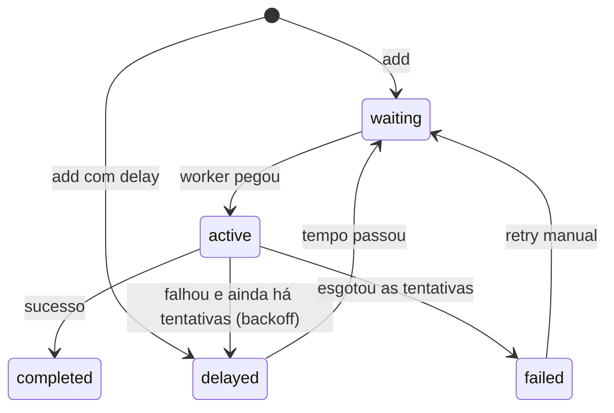

# 22 — Filas de jobs e BullMQ

> **Épicos:** E14.
> **Onde:** módulo `async` (API), worker em `apps/consumers`.
> **ADR:** 002 (BullMQ para jobs, RabbitMQ para eventos).

---

## 1. O problema

"Classifique 50 mil tickets" não cabe numa requisição HTTP: levaria horas, a conexão cairia e um erro no ticket 30 mil faria perder tudo. É preciso **aceitar o pedido na hora**, processar em segundo plano com concorrência controlada, repetir o que falhar e guardar o que falhar sempre, sem perder nada.

## 2. Como funciona

### 2.1 Fila de jobs × fila de eventos

| | Evento (RabbitMQ, [20](./20-mensageria-e-rabbitmq.md)) | Job (BullMQ) |
|---|---|---|
| Semântica | "Algo **aconteceu**" | "**Faça** isto" |
| Consumidores | Vários interessados (fan-out) | Um worker executa |
| Estado | Some após o ack | Tem ciclo de vida consultável: aguardando, ativo, concluído, falhou |
| Resultado | Não há | Há um resultado, que o cliente consulta |
| Recursos típicos | Roteamento, DLX | Retry com backoff, atraso, prioridade, limite de taxa, progresso |

Essa diferença sustenta o ADR 002. Usar só um dos dois é possível, mas força uma ferramenta a fazer o papel da outra (ver a seção 5).

### 2.2 O modelo do BullMQ

BullMQ é uma biblioteca Node que implementa filas de jobs **sobre o Redis**, com scripts Lua para garantir atomicidade.

```ts
const queue = new Queue("async-chat", { connection });
await queue.add("chat", payload, {
  jobId,
  attempts: 5,
  backoff: { type: "exponential", delay: 1000 },
  removeOnComplete: { age: 86400 },
});

new Worker("async-chat", async (job) => runInferencePipeline(job.data), {
  connection,
  concurrency: 10,
});
```

**Ciclo de vida de um job:**



**Recursos relevantes:**

- **Retries com backoff** (`attempts`, `backoff`).
- **Concorrência** por worker e **rate limiter** por fila.
- **Locks e stalled jobs:** um worker ativo renova um lock no Redis. Se ele morrer, o job é detectado como *stalled* e volta para a fila. Por isso o processamento é **at-least-once** e precisa ser idempotente.
- **Prioridades, jobs atrasados e repetíveis** (cron).
- **Flows:** jobs pai/filho (útil para batch: um pai "lote" com N filhos).
- **Eventos** (`completed`, `failed`) para acompanhar o progresso.

### 2.3 DLQ no BullMQ

O BullMQ **não tem DLQ nativa** como o RabbitMQ: jobs que esgotam as tentativas ficam no estado `failed`, guardados no Redis. "DLQ" aqui significa:

- manter os falhos (não usar `removeOnFail` agressivo), ou movê-los para uma fila própria;
- expor um endpoint para listar e **reprocessar** (`job.retry()`).

### 2.4 Batch com concorrência por tenant

N prompts → N jobs. Para que um tenant com 50 mil itens não monopolize os workers, é preciso limitar a concorrência **por tenant**: filas por tenant, *group keys* (recurso do BullMQ Pro) ou um controle próprio no Redis. É uma decisão do E14.

### 2.5 Fluxo completo do projeto

1. `POST /v1/async/chat/completions` → valida, cria `async_jobs` no Postgres, enfileira, responde `202` + `job_id`.
2. Worker executa **a mesma esteira** do síncrono (rate limit, cache, custo, fallback).
3. Sucesso → salva o resultado e enfileira o webhook ([23](./23-webhooks-hmac-e-ssrf.md)).
4. Falha definitiva → estado `failed` ("DLQ") + endpoint de reprocessamento.
5. `GET /v1/async/jobs/{id}` → status e resultado.

## 3. Analogia

É a **fila de pedidos de uma lavanderia**. Você entrega a roupa, recebe um **tíquete** (o `job_id`) e vai embora. As máquinas (workers) lavam algumas peças por vez (concorrência). Se uma lavagem dá problema, tentam de novo mais tarde (retry com backoff). Se uma peça não fica limpa de jeito nenhum, vai para uma prateleira separada com uma etiqueta explicando o problema (failed/DLQ), e não para o lixo. Você volta com o tíquete para buscar, ou a lavanderia te manda uma mensagem quando terminar (webhook).

## 4. Por que está nesta arquitetura

- Requisito do CONTEXT.md §4.7: tarefas longas, lotes, nenhum pedido perdido.
- O Redis já está no projeto; o BullMQ não exige outro serviço.
- Estado do job consultável, retry, atraso e concorrência prontos, que seriam trabalhosos de construir sobre o RabbitMQ.

## 5. Ferramentas similares

| Ferramenta | Plataforma / base | Diferença principal |
|---|---|---|
| **BullMQ** | Node / Redis | Rico em recursos, TypeScript, ativo. **A escolha do projeto** |
| **Bull, Bee-Queue** | Node / Redis | Antecessores (Bull) ou mais simples (Bee-Queue) |
| **pg-boss, Graphile Worker** | Node / **Postgres** | Fila no próprio Postgres (`SKIP LOCKED`), sem Redis; transacional com seus dados |
| **Agenda** | Node / MongoDB | Agendamento de tarefas |
| **Sidekiq** (Ruby), **Celery** (Python) | Redis/RabbitMQ | Equivalentes clássicos em outras linguagens |
| **RabbitMQ como fila de tarefas** | Broker | Funciona, mas sem estado consultável nem resultado; você constrói por cima |
| **Temporal, Inngest, Trigger.dev** | Orquestração durável | Workflows com vários passos, estado durável e retries por etapa; mais poder, mais infraestrutura |
| **SQS + Lambda** | Gerenciado (AWS) | Zero servidor; limites de tempo de execução |

## 6. Armadilhas

- **At-least-once:** um job pode rodar duas vezes (stalled, crash). Não pode **cobrar duas vezes** nem disparar dois webhooks com efeito.
- **Redis com eviction ligada** apaga jobs. O BullMQ exige `maxmemory-policy noeviction`.
- **Payloads grandes no Redis:** guardar prompts enormes em cada job consome memória; guarde no Postgres e passe só o ID.
- **Rate limit aplicado só no enfileiramento:** o worker também precisa respeitar o limite do tenant e do provedor.
- **Jobs concluídos acumulando** no Redis sem `removeOnComplete`.
- **Redis fora do ar** → rotas assíncronas respondem `503` (definido na arquitetura).

## 7. No Portunus

- E14: filas `async-chat` e `webhooks`, tabela `async_jobs`, endpoints de criação e consulta, worker em `apps/consumers`, batch com concorrência por tenant, falhos e reprocessamento.

## 8. Para aprofundar

- BullMQ — documentação: https://docs.bullmq.io/
- BullMQ — *Retrying failing jobs*: https://docs.bullmq.io/guide/retrying-failing-jobs
- BullMQ — *Stalled jobs*: https://docs.bullmq.io/guide/jobs/stalled
- pg-boss (para comparar a abordagem só com Postgres): https://github.com/timgit/pg-boss
