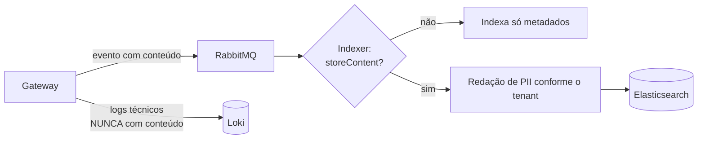

# 25 — PII e privacidade

> **Épicos:** E13 (redação antes de indexar); E0 e E6 (logs sem conteúdo).
> **Onde:** consumidor Indexer, configurações do tenant (`storeContent`, redação), logger.

---

## 1. O problema

Usuários colocam de tudo em prompts: e-mails, CPFs, telefones, números de cartão, endereços, dados de saúde. Se o gateway guardar isso sem cuidado, vira um repositório gigante de dados pessoais: um alvo de ataque e um problema legal (LGPD). Ao mesmo tempo, poder buscar o conteúdo é útil para auditoria e depuração.

## 2. Como funciona

### 2.1 Conceitos

- **PII (*Personally Identifiable Information*)** / **dado pessoal (LGPD):** qualquer informação que identifique uma pessoa, direta ou indiretamente.
- **Dado pessoal sensível (LGPD):** saúde, religião, biometria, origem racial etc. Exige cuidado extra.
- **Minimização:** guardar só o necessário, pelo tempo necessário.

### 2.2 Técnicas de proteção

| Técnica | O que faz | Reversível? | Exemplo |
|---|---|---|---|
| **Redação (redaction)** | Substitui pelo tipo | Não | `joao@x.com` → `[EMAIL]` |
| **Mascaramento parcial** | Esconde parte | Não | `123.456.789-09` → `***.***.***-09` |
| **Pseudonimização / tokenização** | Troca por um token; o mapeamento fica guardado à parte | Sim, com o cofre | `joao@x.com` → `tok_8f3a` |
| **Hash** | Substitui por um hash | Não (mas pode ser vulnerável a dicionário) | Permite contar ocorrências sem ver o valor |
| **Não armazenar** | Guarda só os metadados | — | `storeContent=false` |

### 2.3 Detecção

| Abordagem | Como | Prós | Contras |
|---|---|---|---|
| **Regex + validação** | Padrões para e-mail, CPF, telefone, cartão; validar o **dígito verificador do CPF** e o **algoritmo de Luhn** para cartão | Rápido, previsível, sem custo | Só pega formatos conhecidos; falsos positivos (todo número de 11 dígitos?) |
| **NER (reconhecimento de entidades)** | Modelos de linguagem detectam nomes, endereços | Pega o que não tem formato fixo | Mais lento, falha de vez em quando, depende do idioma |
| **LLM** | Pedir a um modelo para identificar PII | Flexível | Caro, lento e o dado sai para outro serviço |

**Algoritmo de Luhn** (cartões): da direita para a esquerda, dobra um dígito sim, outro não (subtraindo 9 se passar de 9), soma tudo; o resultado precisa ser múltiplo de 10. É O(n) no número de dígitos e reduz falsos positivos.

**CPF:** dois dígitos verificadores calculados com pesos decrescentes sobre os 9 primeiros dígitos (módulo 11). Validar evita mascarar qualquer sequência de 11 números.

### 2.4 Onde aplicar no projeto

- **Logs de aplicação (Loki):** nunca contêm prompt nem resposta (invariante 5). Isso é garantido no **código** (o que é logado), não por filtro posterior.
- **Elasticsearch:** conteúdo só se o tenant permitir, com redação antes de indexar.
- **Retenção:** ILM apaga após o período definido.
- **Traces e métricas:** sem conteúdo nos atributos dos spans.

### 2.5 E o provedor?

O conteúdo vai, inevitavelmente, para o provedor de LLM. Redigir **antes** de enviar ao provedor muda a resposta ("[EMAIL]" no lugar do e-mail) e é outra feature (*guardrails* de entrada), fora do escopo atual. O que cabe ao gateway: não multiplicar as cópias do dado e controlar o que ele mesmo guarda.

## 3. Analogia

É o **arquivo de um consultório médico**. O médico precisa ouvir tudo (o provedor vê o prompt), mas a recepcionista que organiza as fichas para estatística vê só "paciente 4471, consulta de 30 min, convênio X" (metadados). Quando a ficha completa precisa ser guardada, os dados que não interessam para a auditoria são cobertos com tarja preta (redação). E, após o prazo legal, as fichas vão para o triturador (retenção).

## 4. Por que está nesta arquitetura

- CONTEXT.md §4.8: mascarar dados sensíveis e permitir não guardar conteúdo.
- LGPD: minimização, finalidade e segurança.
- Separar logs técnicos (sem conteúdo) de registros de requisição (com conteúdo controlado) reduz drasticamente a superfície de vazamento.

## 5. Ferramentas similares

| Ferramenta | Diferença |
|---|---|
| **Microsoft Presidio** | Open source (Python); combina regex, NER e regras; detecção e anonimização; suporta reconhecedores customizados |
| **AWS Comprehend (PII), Google Cloud DLP / Sensitive Data Protection** | Serviços gerenciados; o dado sai para a nuvem |
| **Regex próprio + validadores** | Sem dependência, controlado, limitado aos formatos conhecidos. Ponto de partida do projeto |
| **Guardrails de LLM** (ex.: NeMo Guardrails, Guardrails AI, Lakera) | Filtram entrada/saída do modelo (PII, prompt injection, toxicidade) |
| **Redação no logger** (`redact` do pino) | Remove **campos** conhecidos de objetos de log; não detecta PII dentro de texto livre |

## 6. Armadilhas

- **Redação nunca é 100%.** Formatos inesperados escapam ("meu cpf é 123 456 789 09"). Combine com `storeContent=false` e retenção curta para clientes sensíveis.
- **Falsos positivos** destroem o valor de busca (mascarar todo número).
- **PII em lugares inesperados:** mensagens de erro, nomes de arquivos, atributos de spans, a URL de webhook.
- **Backups e réplicas** também guardam o dado; a retenção precisa valer para eles.
- **Redação reversível** exige proteger o "cofre" com o mesmo cuidado do dado original.
- **Testes com dados reais:** use dados sintéticos (CPFs válidos gerados, e-mails fictícios).

## 7. No Portunus

- E0/E6: logger configurado para nunca receber conteúdo; `redact` do pino para campos sensíveis conhecidos (ex.: `authorization`).
- E2: flags do tenant (`storeContent`, redação).
- E13: redação no Indexer (e-mail, CPF com dígito verificador, telefone, cartão com Luhn) e a decisão de regex × biblioteca.

## 8. Para aprofundar

- LGPD (Lei 13.709/2018): https://www.planalto.gov.br/ccivil_03/_ato2015-2018/2018/lei/l13709.htm
- Microsoft Presidio: https://microsoft.github.io/presidio/
- OWASP — *Logging Cheat Sheet* (o que não logar): https://cheatsheetseries.owasp.org/cheatsheets/Logging_Cheat_Sheet.html
- pino — *Redaction*: https://getpino.io/#/docs/redaction
