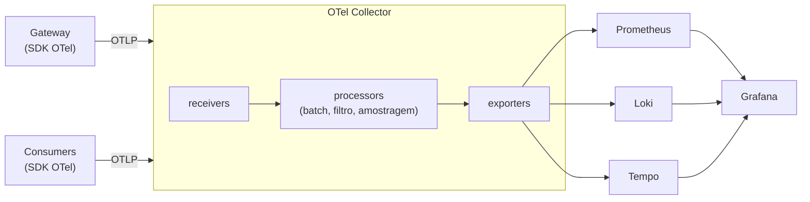

# 26 — Observabilidade e OpenTelemetry

> **Épicos:** E6 (fundação); de E7 em diante, cada épico instrumenta o que constrói.
> **Onde:** `libs/telemetry`, `infra/otel/`, perfil `observability` do Compose.

---

## 1. O problema

Um sistema com gateway, Redis, Postgres, RabbitMQ, consumidores e provedores externos falha de formas que ninguém previu. "O p95 subiu ontem às 15h": foi o provedor? O cache? O Postgres? Um tenant específico? Sem dados, a resposta é palpite. E cada ferramenta (métricas, logs, traces) com sua própria biblioteca e formato vira um zoológico de agentes.

## 2. Como funciona

### 2.1 Monitoramento × observabilidade

- **Monitoramento:** acompanhar perguntas **conhecidas** ("a taxa de erro passou de 5%?").
- **Observabilidade:** a capacidade de responder perguntas **novas** sobre o sistema a partir dos dados que ele emite, sem precisar subir código novo ("por que só as requisições do tenant X com o alias `inteligente` estão lentas desde as 15h?").

### 2.2 Os três sinais

| Sinal | O que é | Responde | Custo | Ferramenta no projeto |
|---|---|---|---|---|
| **Métricas** | Números agregados ao longo do tempo | "Quanto? Com que frequência?" | Baixo (agregado) | Prometheus ([27](./27-metricas-e-prometheus.md)) |
| **Logs** | Registros de eventos discretos | "O que aconteceu exatamente?" | Médio/alto | Loki ([28](./28-logs-pino-e-loki.md)) |
| **Traces** | O caminho de uma requisição pelos componentes | "Onde o tempo foi gasto? Quem chamou quem?" | Médio (com amostragem) | Tempo ([29](./29-tracing-e-tempo.md)) |

O poder vem da **correlação**: uma métrica mostra o pico → um exemplo (*exemplar*) leva ao trace → o trace leva aos logs daquela requisição pelo `trace_id`.

### 2.3 OpenTelemetry (OTel)

Um padrão aberto (projeto da CNCF) para **gerar, coletar e exportar** telemetria, independente de fornecedor. Suas partes:

- **API:** o que o código usa para criar spans e métricas (`tracer.startActiveSpan(...)`, `meter.createCounter(...)`).
- **SDK:** a implementação: amostragem, processamento em lote, exportação.
- **Instrumentações automáticas:** bibliotecas que instrumentam HTTP, Fastify, `pg`, `ioredis`, `amqplib` sem você escrever código.
- **OTLP:** o protocolo de envio (gRPC ou HTTP).
- **Collector:** um serviço separado que **recebe**, **processa** e **exporta** telemetria.
- **Semantic conventions:** nomes padronizados de atributos (`http.request.method`, `db.system`...). Existem convenções em desenvolvimento para GenAI (`gen_ai.request.model`, `gen_ai.usage.input_tokens`...), muito relevantes para este projeto.

**Por que um Collector no meio?** A aplicação fala só OTLP com um destino; o Collector decide para onde vai cada sinal, faz batch, filtra dados sensíveis, amostra e tenta de novo. Trocar o Tempo pelo Jaeger, por exemplo, é só configuração do Collector.

### 2.4 Contexto e propagação

Para um trace atravessar processos, o contexto (trace id + span id) viaja junto:

- **HTTP:** header `traceparent` (padrão **W3C Trace Context**).
- **RabbitMQ:** headers da mensagem.
- **BullMQ:** dados do job.

No Node, o OTel usa `AsyncLocalStorage` para que o contexto "siga" o fluxo assíncrono sem ser passado à mão.

### 2.5 O que medir: métodos clássicos

- **Golden signals** (Google SRE): latência, tráfego, erros e saturação.
- **RED** (para serviços): *Rate*, *Errors*, *Duration*.
- **USE** (para recursos): *Utilization*, *Saturation*, *Errors*.

### 2.6 SLI, SLO e SLA

- **SLI:** o indicador medido (ex.: % de requisições com sucesso abaixo de 2 s).
- **SLO:** o objetivo interno (ex.: 99,5% em 30 dias).
- **SLA:** o contrato com o cliente, com penalidade.
- **Error budget:** 100% − SLO. Quanto de falha é "permitido" antes de parar features e focar em estabilidade.

## 3. Analogia

O sistema é um **paciente**:

- **Métricas** são os **sinais vitais** no monitor (batimento, pressão, temperatura): baratos, contínuos e ótimos para disparar um alarme.
- **Logs** são o **prontuário**: o que aconteceu, quando e com detalhes.
- **Traces** são o **exame de imagem com contraste**: mostram o caminho exato por onde o problema passou.
- O **OpenTelemetry** é o **padrão de conexão dos sensores**: qualquer sensor encaixa em qualquer monitor, e trocar de marca de monitor não exige reinstalar os sensores.

## 4. Por que está nesta arquitetura

- CONTEXT.md §4.9: ver em tempo real, seguir uma requisição etapa por etapa, alertas.
- Trazido para o E6 (e não para o fim) para **usar** a telemetria ao construir retry, fallback e cache: ver o trace de um fallback ensina mais que ler sobre ele.
- O OTel evita lock-in: os mesmos dados podem ir para Grafana, Datadog ou Honeycomb sem mudar o código.

## 5. Ferramentas similares

| Ferramenta | Tipo | Diferença |
|---|---|---|
| **OpenTelemetry** | Padrão aberto + SDKs | Neutro, sinais unificados. **A escolha do projeto** |
| **Datadog, New Relic, Dynatrace** | Plataformas SaaS completas | Tudo integrado, agentes próprios (aceitam OTel); caras em volume |
| **Honeycomb** | SaaS focado em eventos de alta cardinalidade | Excelente para observabilidade "pura"; nativo em OTel |
| **Grafana Cloud / stack LGTM** (Loki, Grafana, Tempo, Mimir) | Open source ou SaaS | **A stack local do projeto** |
| **Elastic Observability** | ES para logs, métricas e APM | Unifica com a busca |
| **Prometheus client direto** (`prom-client`) | Só métricas | Mais simples, sem traces |
| **Langfuse, Helicone, LangSmith** | Observabilidade específica de LLM | Prompts, custo e avaliações; complementares |

## 6. Armadilhas

- **Telemetria derrubando a aplicação:** o Collector fora do ar não pode travar requisições. Exportação assíncrona, em lote, com descarte.
- **Cardinalidade** (ver [27](./27-metricas-e-prometheus.md)): `request_id` como label de métrica derruba o Prometheus (invariante 6).
- **Conteúdo sensível em atributos de span** (prompts!): invariante 5 vale para traces também.
- **Instrumentar tudo e não olhar nada:** cada métrica precisa responder a uma pergunta ou alimentar um alerta.
- **Ordem de inicialização:** o SDK do OTel precisa ser carregado **antes** dos módulos instrumentados (`http`, `pg`...), senão a auto-instrumentação não funciona.
- **Overhead:** spans e métricas custam CPU. Amostragem para traces em carga alta.

## 7. No Portunus

- E6: `libs/telemetry`, auto-instrumentação, spans por etapa da esteira, métricas base, Collector, perfil `observability`, dashboard "Visão geral".
- Daí em diante, cada épico entrega suas métricas e spans (regra transversal do ROADMAP).

## 8. Para aprofundar

- OpenTelemetry — documentação (conceitos e JS): https://opentelemetry.io/docs/
- OpenTelemetry — *Semantic conventions for GenAI*: https://opentelemetry.io/docs/specs/semconv/gen-ai/
- Google SRE Book — *Monitoring Distributed Systems*: https://sre.google/sre-book/monitoring-distributed-systems/
- W3C — *Trace Context*: https://www.w3.org/TR/trace-context/
- Livro: *Observability Engineering* (Majors, Fong-Jones, Miranda)
