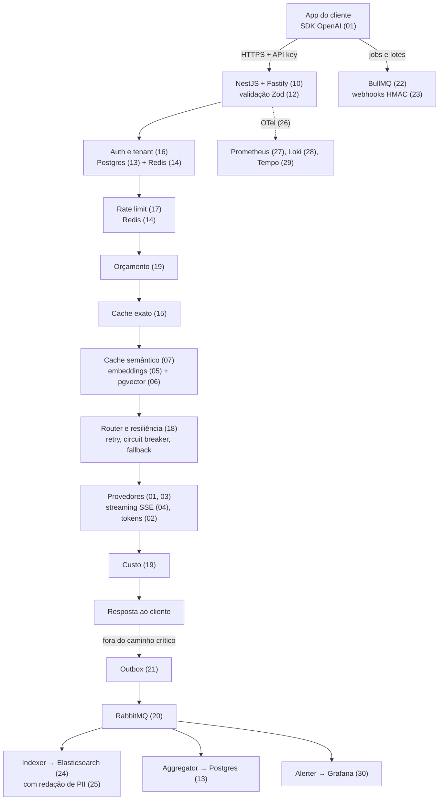

# Estudos — o que é preciso saber para construir o Portunus

> Material de estudo do projeto. Cada arquivo explica **um conteúdo**: o que é, como funciona por dentro, por que está nesta arquitetura, quais são as alternativas e o que costuma dar errado.
> A ideia é que, ao terminar a leitura, você consiga explicar cada peça do [`ARQUITETURA.md`](../../ARQUITETURA.md) com as próprias palavras.

---

## Como cada documento está organizado

Todos seguem a mesma estrutura, para facilitar a comparação entre eles:

1. **O problema** — a dor que existe sem essa peça.
2. **Como funciona** — a explicação técnica, com os nomes corretos dos conceitos.
3. **Analogia** — uma imagem do mundo real para fixar.
4. **Por que está nesta arquitetura** — o papel exato no Portunus.
5. **Ferramentas similares** — alternativas, diferenças e quando cada uma faz mais sentido.
6. **Armadilhas** — o que um dev pleno precisa ter na cabeça.
7. **No Portunus** — em quais épicos e módulos aparece.
8. **Para aprofundar** — documentação oficial e leituras clássicas.

## Trilha de leitura

A ordem abaixo segue a ordem em que os conteúdos aparecem no [`ROADMAP.md`](../../ROADMAP.md). Não é preciso ler tudo antes de começar: leia a trilha do épico em que você está.

### Parte 1 — AI Engineering

| #   | Documento                                                      | Épicos     |
| --- | -------------------------------------------------------------- | ---------- |
| 01  | [LLMs e a API de chat](./01-llms-e-a-api-de-chat.md)           | E3, E4, E7 |
| 02  | [Tokens e tokenização](./02-tokens-e-tokenizacao.md)           | E4, E5, E8 |
| 03  | [O que é um LLM gateway](./03-llm-gateway.md)                  | todos      |
| 04  | [Streaming e Server-Sent Events](./04-streaming-e-sse.md)      | E5         |
| 05  | [Embeddings](./05-embeddings.md)                               | E10, E15   |
| 06  | [Busca vetorial e pgvector](./06-busca-vetorial-e-pgvector.md) | E10        |
| 07  | [Cache semântico](./07-cache-semantico.md)                     | E10        |
| 08  | [Evals](./08-evals.md)                                         | E15        |

### Parte 2 — Fundamentos de back-end

| #   | Documento                                                                      | Épicos              |
| --- | ------------------------------------------------------------------------------ | ------------------- |
| 09  | [Monorepo, pnpm e TypeScript](./09-monorepo-pnpm-e-typescript.md)              | E0                  |
| 10  | [NestJS e Fastify](./10-nestjs-e-fastify.md)                                   | E0, E3              |
| 11  | [Clean Architecture e design patterns](./11-clean-architecture-e-padroes.md)   | todos               |
| 12  | [Validação com Zod](./12-validacao-com-zod.md)                                 | E0, E3, E11, E15    |
| 13  | [PostgreSQL e Drizzle ORM](./13-postgresql-e-drizzle.md)                       | E2, E4, E11, E12    |
| 14  | [Redis](./14-redis.md)                                                         | E2, E7, E8, E9, E14 |
| 15  | [Cache (fundamentos e cache exato)](./15-cache-exato.md)                       | E9                  |
| 16  | [API keys, autenticação e multi-tenancy](./16-api-keys-e-multi-tenancy.md)     | E2                  |
| 17  | [Rate limiting](./17-rate-limiting.md)                                         | E8                  |
| 18  | [Resiliência: timeout, retry, circuit breaker e fallback](./18-resiliencia.md) | E7                  |
| 19  | [Custo, dinheiro e orçamento](./19-custo-dinheiro-e-orcamento.md)              | E4, E8, E12         |

### Parte 3 — Assincronia e dados

| #   | Documento                                                                    | Épicos        |
| --- | ---------------------------------------------------------------------------- | ------------- |
| 20  | [Mensageria e RabbitMQ](./20-mensageria-e-rabbitmq.md)                       | E11           |
| 21  | [Outbox, idempotência e garantias de entrega](./21-outbox-e-idempotencia.md) | E11, E12, E14 |
| 22  | [Filas de jobs e BullMQ](./22-filas-de-jobs-e-bullmq.md)                     | E14           |
| 23  | [Webhooks, HMAC e SSRF](./23-webhooks-hmac-e-ssrf.md)                        | E14           |
| 24  | [Elasticsearch](./24-elasticsearch.md)                                       | E13           |
| 25  | [PII e privacidade](./25-pii-e-privacidade.md)                               | E13           |

### Parte 4 — Observabilidade

| #   | Documento                                                                  | Épicos       |
| --- | -------------------------------------------------------------------------- | ------------ |
| 26  | [Observabilidade e OpenTelemetry](./26-observabilidade-e-opentelemetry.md) | E6 em diante |
| 27  | [Métricas e Prometheus](./27-metricas-e-prometheus.md)                     | E6 em diante |
| 28  | [Logs estruturados, pino e Loki](./28-logs-pino-e-loki.md)                 | E0, E6       |
| 29  | [Tracing distribuído e Tempo](./29-tracing-e-tempo.md)                     | E6, E7, E11  |
| 30  | [Grafana e alertas](./30-grafana-e-alertas.md)                             | E6, E12      |

### Parte 5 — Qualidade e operação

| #   | Documento                                                                      | Épicos       |
| --- | ------------------------------------------------------------------------------ | ------------ |
| 31  | [Testes: Vitest, TDD e Testcontainers](./31-testes-vitest-e-testcontainers.md) | todos        |
| 32  | [Testes de carga e de caos (k6)](./32-testes-de-carga-e-caos.md)               | E3, E16      |
| 33  | [Docker e Docker Compose](./33-docker-e-compose.md)                            | E0 em diante |
| 34  | [CI com GitHub Actions](./34-ci-github-actions.md)                             | E0, E15      |

## O mapa: onde cada peça entra numa requisição

## Conceitos que atravessam vários documentos

Você vai ver estas ideias repetidas em vários lugares. Vale reconhecer quando elas aparecem:

- **Caminho crítico:** tudo o que acontece entre a requisição chegar e a resposta sair. Cada milissegundo e cada dependência ali conta. O que não precisa estar ali (logs, indexação, métricas) sai dali.
- **Fail-open × fail-closed:** quando uma proteção cai, você deixa passar (aberto) ou bloqueia tudo (fechado)? Rate limit no gateway é fail-open; autenticação é sempre fail-closed.
- **At-least-once e idempotência:** em sistemas distribuídos, "exatamente uma vez" é caro ou impossível. Aceita-se entregar mais de uma vez e torna-se o processamento repetível sem efeito duplicado.
- **Isolamento por tenant:** todo dado, chave, cache e métrica é separado por cliente.
- **Cardinalidade:** o número de combinações distintas de um valor. Explode o custo de métricas, índices e caches se for ignorada.
- **Big-O:** a forma como o custo de uma operação cresce com o tamanho da entrada. Aparece em rate limit, cache, busca vetorial e índices de banco.
