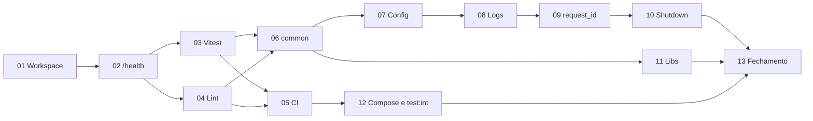

# E0 — Tickets

Tickets do épico [E0 — Fundação do monorepo](../spec.md). Cada ticket é uma fatia vertical, pequena o bastante para ser lida inteira e verificável sozinha. Ao fim de cada um, paro para revisão antes de seguir.

## Sequência

| #   | Ticket                                                                               | Bloqueado por | Status |
| --- | ------------------------------------------------------------------------------------ | ------------- | ------ |
| 01  | [Raiz do workspace com Node e pnpm fixados](./01-raiz-do-workspace.md)               | —             | done   |
| 02  | [Gateway responde `GET /health`](./02-gateway-responde-health.md)                    | 01            | done   |
| 03  | [Testes unitários pelo seam do app](./03-testes-unitarios-pelo-seam-do-app.md)       | 02            | done   |
| 04  | [Lint e formatação com a regra de camadas](./04-lint-e-formatacao.md)                | 02            | done   |
| 05  | [CI de qualidade e proteção da `main`](./05-ci-de-qualidade-e-protecao-da-main.md)   | 03, 04        | done   |
| 06  | [Primeira lib compartilhada: `@portunus/common`](./06-primeira-lib-compartilhada.md) | 03, 04        | done   |
| 07  | [Contrato de configuração do gateway](./07-contrato-de-configuracao.md)              | 06            | done   |
| 08  | [Logs estruturados com pino](./08-logs-estruturados.md)                              | 07            | done   |
| 09  | [`request_id` e redação de dados sensíveis](./09-request-id-e-redacao.md)            | 08            | done   |
| 10  | [Graceful shutdown](./10-graceful-shutdown.md)                                       | 09            | done   |
| 11  | [Esqueletos das libs restantes](./11-esqueletos-das-libs.md)                         | 06            | done   |
| 12  | [Compose `core` e testes de integração](./12-compose-core-e-testes-de-integracao.md) | 05            | done   |
| 13  | [Fechamento do épico](./13-fechamento-do-epico.md)                                   | 01–12         | done   |

## Dependências

Depois do 06, existem três trilhas independentes: **07 → 08 → 09 → 10** (gateway), **11** (libs) e **12** (infra e integração, que só depende do CI). A ordem numérica é a recomendada.

## Decisões que precisam estar confirmadas antes do ticket

Vêm das "Decisões a confirmar" da [spec](../spec.md#decisões-a-confirmar-na-revisão-desta-spec). Cada ticket abaixo começa confirmando a sua.

| Decisão                                                       | Ticket |
| ------------------------------------------------------------- | ------ |
| Dependências novas do ferramental (TypeScript, Nest, Fastify) | 02     |
| Contrato do `GET /health`                                     | 02     |
| Dependências de teste (Vitest, SWC)                           | 03     |
| Dependências de lint e formatação                             | 04     |
| Estratégia de resolução de pacotes (opção C, ADR 011) e `zod` | 06     |
| Logger `nestjs-pino` e suas dependências                      | 08     |
| Contrato do header `x-request-id`                             | 09     |
| Testcontainers                                                | 12     |

## Definição de pronto (vale para todo ticket)

1. Critérios de aceite do ticket marcados.
2. Verificação do CLAUDE.md §5 com o que já existe até aquele ticket: `pnpm typecheck`, `pnpm lint`, `pnpm test`, `pnpm test:int` e `curl` na rota afetada. Se um passo ainda não existe (ex.: `test:int` antes do 12), dizer isso explicitamente.
3. Script novo no `package.json` raiz → seção de comandos do CLAUDE.md atualizada no mesmo ticket.
4. Decisão nova → ADR no mesmo ticket.
5. Branch curta (`chore/...`, `feat/...`), Conventional Commits com escopo e PR em português. A partir do ticket 05, o PR só entra com o CI verde.
6. Explicação técnica e didática do que foi feito e por quê, e uma parada para revisão.
