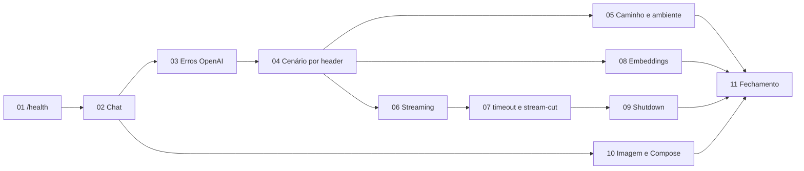

# E1 — Tickets

Tickets do épico [E1 — Provedor mock](../spec.md). Cada ticket é uma fatia vertical, pequena o bastante para ser lida inteira e verificável sozinha. Ao fim de cada um, paro para revisão antes de seguir.

## Sequência

| #   | Ticket                                                                                           | Bloqueado por | Status          |
| --- | ------------------------------------------------------------------------------------------------ | ------------- | --------------- |
| 01  | [Mock responde `GET /health`](./01-mock-responde-health.md)                                      | —             | done            |
| 02  | [Chat completion normal e determinística pelo SDK](./02-chat-completion-deterministica.md)       | 01            | done            |
| 03  | [Erros no formato da OpenAI na fronteira do mock](./03-erros-no-formato-da-openai.md)            | 02            | ready-for-agent |
| 04  | [Cenário por header: latência e erros HTTP](./04-cenario-por-header.md)                          | 03            | done            |
| 05  | [Cenário pelo caminho e pelo ambiente, com precedência](./05-cenario-pelo-caminho-e-ambiente.md) | 04            | ready-for-agent |
| 06  | [Streaming SSE](./06-streaming-sse.md)                                                           | 04            | ready-for-agent |
| 07  | [Falhas no tempo: `timeout` e `stream-cut`](./07-timeout-e-stream-cut.md)                        | 06            | ready-for-agent |
| 08  | [Embeddings determinísticos](./08-embeddings-deterministicos.md)                                 | 04            | ready-for-agent |
| 09  | [Graceful shutdown com esperas simuladas em andamento](./09-graceful-shutdown.md)                | 07            | ready-for-agent |
| 10  | [Imagem do mock, Compose `core` e teste de integração](./10-imagem-compose-e-integracao.md)      | 02            | in-review       |
| 11  | [Fechamento do épico](./11-fechamento-do-epico.md)                                               | 01–10         | ready-for-agent |

## Dependências

O 10 pode ser feito em paralelo a partir do 02. Depois do 04, existem três trilhas independentes: **05**, **06 → 07 → 09** e **08**. A ordem numérica é a recomendada.

## Decisões que precisam estar confirmadas antes do ticket

Vêm das "Decisões a confirmar" da [spec](../spec.md#decisões-a-confirmar-na-revisão-desta-spec). Cada ticket abaixo começa confirmando a sua.

| Decisão                                                             | Ticket |
| ------------------------------------------------------------------- | ------ |
| 1. Fastify puro, sem Nest                                           | 01     |
| 7. Dependências `fastify`, `zod`, `@portunus/common`, `pino-pretty` | 01     |
| 3. Regra de tokens                                                  | 02     |
| 7. Dependência dev `openai`                                         | 02     |
| 2. Gramática do cenário e header `x-mock-scenario`                  | 04     |
| 4. Chunk de `usage` só com `include_usage`                          | 06     |
| 5. `stream-cut` com corte abrupto da conexão                        | 07     |
| 6. Dockerfile do mock e serviço no perfil `core`                    | 10     |
